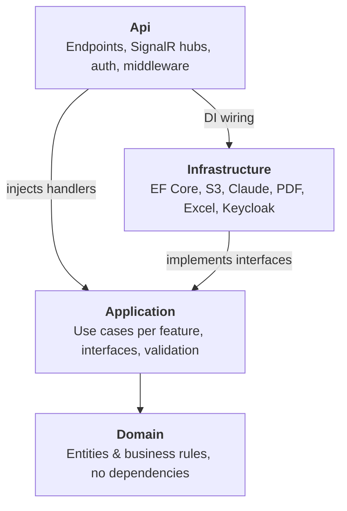

# SchoMans PRD (School Management System)

## How to use this PRD

This is the English version of the PRD and the primary reference; the Indonesian version is updated alongside it. A good PRD for Claude is specific, measurable, and explicit about what is *not* built. Every feature has acceptance criteria that can be checked yes/no, so Claude knows when work is done and can write tests from them.

1. Fill anything in \[square brackets\]. If something is unknown, add it to Open questions instead of leaving it blank.
2. Ask Claude to review before coding: *"Read this PRD. List anything ambiguous, contradictory, or missing, and ask questions before starting."*
3. Work phase by phase from the implementation plan: *"Implement Phase 1 only. Stop when done and show me how to test it."*
4. In Claude Code, save the PRD as `docs/en/PRD.md` (Indonesian: `docs/id/PRD.md`) and reference it from `CLAUDE.md` so it is always in context.
5. Update the PRD whenever a decision changes. The PRD is the source of truth, not the chat history.

## 1. Summary & problem

**Product name:** SchoMans (School Management System)

**One-line summary:** SchoMans brings grading, attendance, assignments, new-student admissions, announcements, administrative approvals, and student and classroom data into one platform for teachers, students, parents, and school staff; it will later grow into a Learning Management System (LMS).

**Problem:** School processes are still manual and scattered across paper, spreadsheets, and WhatsApp groups. Information arrives late, grades and attendance are hard to compile, and administrative approvals can take days.

**Portfolio value:** the project showcases what full-stack recruiters look for: role-based access control for 6 roles, multi-step approval workflows, real-time notifications, PDF generation (report cards, letters), analytics dashboards, and AI integration. Target: a live app with one demo account per role that anyone can try within 2 minutes.

## 2. Goals, non-goals & success metrics

**Goals**

- Centralized student, teacher, and classroom records with Excel import
- School news and announcements delivered in real time to the intended roles
- Assignments given and submitted through the LMS module
- Online admissions: registration, document upload, selection, and result announcement
- Digitized administration with approval workflows (leave, letters, teacher leave)
- Online attendance via QR scan with automatic summary reports
- Digital grading and report cards that parents can follow

**Non-goals (out of scope for v1).** These limits keep the project finishable and stop Claude from adding features nobody asked for.

- Native mobile apps; a responsive web app installable as a PWA is enough
- Real tuition payments; if built at all, sandbox mode only
- Video conferencing or live classes; an AI tutor for students
- Multi-school (multi-tenant) support; the data design stays ready for it

**Success metrics**

| Metric | Target | How to measure |
| --- | --- | --- |
| QR attendance recorded | < 3 s after scan | Manual test with 5 users |
| Announcement reaches recipients | < 5 s, real time | Open 2 browsers, send and observe |
| Administrative approval | From days to < 1 day | Simulate the flow with demo accounts |
| Recruiter tries the app | < 2 min from landing page to dashboard | Demo login button per role |
| Code quality | Test coverage ≥ 70%, CI green | GitHub Actions report |
| Performance | Lighthouse score ≥ 90 | Lighthouse on public pages |

## 3. Users & user stories

**User roles** (each has its own dashboard and permissions):

| Role | Main needs | Device |
| --- | --- | --- |
| Principal | Approvals, school-wide attendance and grade monitoring | Laptop, phone |
| Teacher (incl. homeroom teacher) | Enter grades, give assignments, class attendance, request leave | Laptop |
| Student | View and submit assignments, scan attendance QR, view grades | Phone |
| Parent | Follow their child's grades, attendance, and announcements | Phone |
| Admin staff | Manage master data, admissions, letters, user accounts | Laptop |
| Applicant | A guest who registered for admissions: fill in the form, upload documents, track selection status | Phone |
| Guest | Anonymous visitor without an account: read news, admission info, and awards; use the chatbot; start registration | Phone |

Guest and Applicant are separate: a Guest has no account and no role in Keycloak, while an Applicant has an account with the realm role `Applicant`, assigned automatically on self-registration. The six realm roles are therefore Principal, Teacher, Student, Parent, Admin, and Applicant. After an accepted applicant is enrolled (F-07) the account's role changes to Student.

One parent can be linked to more than one child, and one teacher can also be a homeroom teacher.

**User stories**, format: *As a \[role\], I want \[action\], so that \[benefit\].*

| ID | User story | Priority |
| --- | --- | --- |
| US-01 | As a teacher, I want to create assignments with attachments and a due date, so that students get assignment info easily | Must |
| US-02 | As a student, I want to see my assignments and their due dates, so that I know about new work on time | Must |
| US-03 | As a parent, I want to see my child's academic results and attendance, so that I can follow their progress | Must |
| US-04 | As the principal, I want to approve administrative requests and monitor student and teacher attendance and grades, so that I can oversee the school | Must |
| US-05 | As a guest, I want to see school news, admission info, announcements, and awards, so that I don't miss information | Must |
| US-06 | As a student, I want to check in by scanning a QR code in class, so that my attendance is recorded without a roll call | Must |
| US-07 | As admin staff, I want to import student data from Excel, so that I don't enter hundreds of records by hand | Must |
| US-08 | As an applicant, I want to register online and track my selection status, so that I don't have to visit the school | Must |
| US-09 | As a teacher, I want report cards generated from entered grades, so that I don't compile them by hand each term | Should |
| US-10 | As a teacher, I want AI to draft feedback on essay answers, so that marking is faster | Should |
| US-11 | As a teacher, I want report-card achievement descriptions drafted from grades and notes, so that report cards don't take hours | Should |
| US-12 | As admin staff, I want data from family-card and birth-certificate photos read into the admission form, so that verification is faster with fewer typos | Should |
| US-13 | As the principal, I want to ask about the school in plain language, so that I don't have to open many reports | Should |
| US-14 | As a parent, I want a monthly progress summary of my child in simple language, so that I understand how they are doing without reading grade tables | Must |
| US-15 | As a teacher, I want practice questions generated from my materials, so that I can give quizzes without writing questions from scratch | Should |
| US-17 | As a guest, I want to ask about the school and admissions at any time, so that I don't have to wait for office hours | Should |
| US-18 | As admin staff, I want announcements and letters drafted from short notes, so that routine documents are done faster | Should |

Give every story an ID so it can be referenced when instructing Claude, for example *"implement US-02"*. US-16 was removed together with AI-07.

## 4. Functional requirements

This is the most important section. Every feature needs acceptance criteria that can be checked yes/no, so Claude knows when it is done and can write tests from them.

**Feature map**

| ID | Module | Stories | Priority | Portfolio value |
| --- | --- | --- | --- | --- |
| F-01 | Master data (students, teachers, classrooms, subjects, academic years) | US-07 | Must | CRUD + Excel import |
| F-02 | Authentication & permissions for 6 roles | All | Must | RBAC, security |
| F-03 | QR attendance | US-06 | Must | Rotating QR, anti proxy check-in |
| F-04 | Assignments (basic LMS) | US-01, US-02 | Must | File upload, due dates |
| F-05 | Grading & PDF report cards | US-03, US-09 | Must | PDF generation |
| F-06 | News & announcements | US-05 | Must | Real-time notifications |
| F-07 | Online admissions | US-08 | Must | Multi-step workflow |
| F-08 | Administration & approvals | US-04 | Must | Multi-level workflow |
| F-09 | Analytics dashboard per role | US-03, US-04 | Should | Charts, data insight |
| F-10 | AI features (8 features, AI-01 to AI-09 without AI-07) | US-10–US-18 | Should (AI-01 Must) | Vision, tool use, structured output |
| F-11 | Audit log & email/WhatsApp notifications | All | Should | Enterprise-grade features |

**F-01: Master data** (US-07)

Core records used by every module: students, teachers, classrooms, subjects, academic years, and parent–student links.

- [ ] Admin can create, update, soft delete, and search students, teachers, classrooms, and subjects
- [ ] Import students from an .xlsx file using the template; failed rows are listed with the reason without cancelling the other rows
- [ ] NISN and email are unique; duplicates are rejected with a clear message
- [ ] Rolling over to a new academic year promotes students in bulk
- [ ] Tables support pagination, sorting, and filtering by classroom

**F-02: Authentication & permissions** (all stories)

- [ ] Login through the Keycloak page (themed as SchoMans) with email and password; password reset and email verification are handled by Keycloak. Every student therefore needs a unique email, also in the Excel import
- [ ] Guests browse public pages without logging in; self-registration on the Keycloak page creates an account with the realm role `Applicant`
- [ ] Roles come from realm roles in the token; every API endpoint is protected by a policy, not just hidden in the UI
- [ ] Parents can only see data of children linked to their account
- [ ] Keycloak users are synced to the User table on first login (by `sub`)
- [ ] Demo login buttons for the six realm roles on the login page (demo mode only); a "Browse as guest" link needs no login

**F-03: QR attendance** (US-06)

The teacher shows a QR code on the classroom screen; students scan it with their own phones.

- [ ] The QR code changes every minute (a Hangfire recurring job rotates the secret of every open session) and is only valid for that class session; the previous secret is still accepted for 10 seconds after a rotation so a scan at the changeover is not rejected, so it cannot be shared via photo
- [ ] A scan is recorded in < 3 seconds and appears on the teacher's screen in real time
- [ ] Students who have not scanned are marked absent when the session closes; the teacher can change it to excused or sick
- [ ] Attendance summaries per student, classroom, and month can be exported to Excel
- [ ] Optional: location check (geofence around the school)

Edge cases: a student scans twice → recorded once; a phone without a camera → the teacher can mark attendance manually.

**F-04: Assignments** (US-01, US-02)

- [ ] Teachers create assignments for one or more classrooms: title, description, attachments, due date
- [ ] Students see assignments sorted by nearest due date, with status not submitted / submitted / late
- [ ] Students submit a file (PDF, image, max 10 MB) or text; submissions after the due date are marked late
- [ ] Teachers give a score and feedback; the score flows into F-05 automatically
- [ ] Students are notified when an assignment is created and one day before it is due

**F-05: Grading & report cards** (US-03, US-09)

- [ ] Teachers enter grades per component (assignments, quizzes, midterm, final) with weights configurable per subject
- [ ] Final grade and grade band are calculated automatically
- [ ] Term report cards are generated as print-ready PDFs with the school letterhead
- [ ] Parents and students see grades after the homeroom teacher publishes them

**F-06: News & announcements** (US-05)

- [ ] Admin creates public news (shown on the landing page) or internal announcements targeted at roles or classrooms
- [ ] Rich-text editor with a cover image; draft or published status
- [ ] Internal announcements arrive in real time as in-app notifications with an unread badge
- [ ] Public news pages are SEO friendly (URL slug, meta tags)

**F-07: Online admissions** (US-08)

Flow: register → upload documents → staff verification → selection → announcement → re-registration.

- [ ] Applicants create an account, fill in the form, and upload documents (birth certificate, family card, report card)
- [ ] Staff verify documents; rejected documents can be re-uploaded with a note
- [ ] Registration status is visible on the applicant's dashboard at every stage
- [ ] Results are announced simultaneously on a set date; accepted applicants automatically become students in F-01

**F-08: Administration & approvals** (US-04)

- [ ] Requests: student leave (by parents), teacher leave, certificate letters
- [ ] Configurable multi-level approval chain, for example homeroom teacher → principal
- [ ] Approvers approve or reject with a note; requesters are notified
- [ ] Approved letters are generated as PDFs with an automatic letter number and a QR code for authenticity checks

**F-09: Analytics dashboard** (US-03, US-04)

- [ ] Principal: attendance trend per classroom, average grade per subject, requests awaiting approval
- [ ] Teacher: students with attendance < 80% or grades below the minimum passing score are flagged for attention
- [ ] Parent: monthly chart of the child's grades and attendance

**F-10: AI features** (US-10 to US-18)

Eight AI features are in scope: AI-01 to AI-04 are built in Phase 6, and AI-05, AI-06, AI-08, and AI-09 in Phase 7. AI-07 (student tutor) was removed from scope because it needs heavy guardrails and testing for child users. All features are called from the .NET backend through the Claude API.

Principles for every AI feature:

- [ ] Send as little data as possible to the API; student names are replaced by IDs before sending and mapped back in the backend
- [ ] AI output is always a draft and is only saved or sent after review by a teacher or staff member (human in the loop)
- [ ] Output the system must process is requested as JSON and schema-validated before use
- [ ] Long answers are streamed to the browser over SignalR
- [ ] Daily per-user limits and a monthly budget cap; when exceeded, the feature is disabled with a clear message
- [ ] Every call is logged: feature, user, token count, cost, duration
- [ ] Prompt caching for long system instructions
- [ ] Each feature has a test set (at least 10 cases) to evaluate quality whenever the prompt changes
- [ ] Mock mode for demos and tests, so the app runs without an API key

**AI-01: Progress summary for parents** (US-14, Must)

- [ ] At the start of each month the system drafts a summary per student from the previous month's grades, attendance, assignments, and teacher notes
- [ ] Simple, warm language: one paragraph plus 3 points — what is going well, what needs attention, and a suggestion for parents at home
- [ ] The homeroom teacher reviews and can edit before sending; bulk send after review
- [ ] Parents are notified and can open the history of previous summaries
- [ ] Summaries only use existing data; they never guess causes or label a child negatively

**AI-02: Report-card achievement descriptions** (US-11, Should)

- [ ] From grades per learning objective and teacher notes, AI drafts the achievement description per subject in the Kurikulum Merdeka report-card format
- [ ] Can run in bulk for a classroom; the teacher reviews each student with accept, edit, or regenerate
- [ ] Descriptions must not be word-for-word identical between students

**AI-03: Admission document extraction** (US-12, Should)

- [ ] From photos or PDFs of the family card, birth certificate, and report card, AI extracts data (name, national ID number, date of birth, parents' names, grades) to JSON
- [ ] Extracted fields are highlighted in the form; the applicant or staff must confirm them
- [ ] Mismatches between documents (for example different dates of birth) are flagged for staff

**AI-04: Principal assistant** (US-13, Should)

- [ ] The principal asks questions in plain language; AI uses tool use to call query functions exposed by the backend, such as attendance per classroom, average grades per subject, and pending requests
- [ ] AI never writes SQL; only registered functions with permission checks can be called
- [ ] Answers include the source numbers and links to the related report pages

**AI-05: Rubric-based essay feedback** (US-10, Should)

- [ ] Teachers define a rubric per assignment: criteria, descriptions, and score ranges
- [ ] AI drafts a score per criterion with a short reason and one improvement suggestion for the student
- [ ] The teacher accepts, edits, or rejects the draft; the final score always comes from the teacher
- [ ] Can run in bulk for all submissions of an assignment

**AI-06: Question generator from materials** (US-15, Should)

- [ ] Teachers upload a PDF (max 30 pages) and choose the number of questions, difficulty, and type (multiple choice or short answer)
- [ ] AI returns JSON with questions, options, answer key, and explanations; the JSON is validated before display
- [ ] Teachers edit and save to a question bank per subject
- [ ] Questions from the bank can be assembled into a simple online quiz in the assignments module, auto-graded for multiple choice

**AI-08: School & admissions chatbot** (US-17, Should)

- [ ] Chat widget on the landing page and the parent dashboard
- [ ] Answers come only from published sources: the landing-page widget (anonymous users) uses news articles only, including admission information (category `AdmissionInfo`); the parent-dashboard widget also uses published announcements, but only those targeted at that parent (their role or their children's classrooms). Internal announcements are never shown to anonymous users; the backend retrieves the 5 most relevant passages via SQL Server full-text search and sends them as context
- [ ] Every answer links to its source
- [ ] If the answer is not in the sources, the chatbot says it doesn't know and gives the staff contact, without guessing
- [ ] Public users are rate limited per IP to prevent abuse and runaway cost

**AI-09: Announcement & letter drafts** (US-18, Should)

- [ ] Staff enter the document type, audience, and short notes; AI drafts it in the editor
- [ ] Letterhead, letter number, and signature are filled by the system, not by AI
- [ ] Drafts are never published or sent automatically

**F-11: Audit log & external notifications**

- [ ] Every change to grades, attendance, and approvals is recorded: who, when, old and new values
- [ ] Important notifications are sent by email; WhatsApp is optional through a sandbox gateway

## 5. Non-functional requirements

Write numbers, not adjectives. "Fast" cannot be checked; "page loads in < 2 seconds" can.

| Aspect | Requirement |
| --- | --- |
| Performance | Home page loads in < 2 s on 4G; Lighthouse ≥ 90 on public pages |
| Security | Passwords and sessions handled by Keycloak, permissions checked in the backend, all input validated, login rate limited, uploads checked for type and size |
| Data privacy | Student data is children's data: only authorized parties can see it; demo data uses fictional names |
| Scale | 1 school, up to 1,500 students and 100 teachers |
| Accessibility | Sufficient color contrast, keyboard usable, labels on every form field |
| Devices & browsers | Latest Chrome & Safari, screens from 360 px; installable as a PWA |
| Language & format | English UI by default via i18n (Indonesian can be added as `id`), dates DD/MM/YYYY, Western Indonesia Time (WIB) |
| Quality | Unit + integration test coverage ≥ 70%, 3 main flows tested end to end, CI must be green before merge |

## 6. Tech stack, language conventions & data model

The stack is fixed: .NET 10 backend (latest LTS, supported until November 2028), React + TypeScript frontend with TanStack Query for API data and Zustand for browser state, SQL Server, EF Core, and Keycloak for authentication. Everything is free for a portfolio; only the Claude API and hosting cost money (see the License column).

| Layer | Choice | Notes | License |
| --- | --- | --- | --- |
| Backend | ASP.NET Core Web API on .NET 10 LTS | Clean Architecture: Domain, Application, Infrastructure, Api | Free (MIT) |
| ORM | Entity Framework Core 10 | Code-first + migrations; demo seed data via migration or seeder | Free (MIT) |
| Database | SQL Server 2022: Developer locally, Express for the live demo | Developer is for dev/test only; Express allows production with a 10 GB per-database limit, enough for the demo | Free with conditions |
| Authentication | Keycloak (realm `schomans`) | OIDC Authorization Code + PKCE; 6 roles as realm roles | Free (Apache 2.0) |
| API authorization | JWT Bearer from Keycloak + policy-based authorization | Ownership checks (e.g. parent → their child) in the Application layer | Free |
| Validation | FluentValidation | Consistent errors in ProblemDetails format | Free (Apache 2.0) |
| Real time | SignalR (self-hosted) | Live QR attendance and in-app notifications; no Azure SignalR Service | Free (MIT) |
| Background jobs | Hangfire core (SQL Server storage) | Due-date reminders, QR rotation (recurring job every minute), scheduled admission announcements | Free (LGPL); Pro features not used |
| File storage | S3 API via AWSSDK.S3: SeaweedFS in Docker locally, Cloudflare R2 for the live demo | Assignment files, admission documents, news images. One S3FileStorage implementation behind IFileStorage; local and demo differ only by endpoint config. MinIO is not used because its community edition was cut back in 2025 | Free (SeaweedFS Apache 2.0; R2 free tier, billed above quota) |
| PDF | QuestPDF | Report cards and numbered letters with verification QR | Free (Community License, individuals & revenue < USD 1M) |
| Excel import/export | ClosedXML | Student import, attendance export | Free (MIT) |
| Frontend | React 19 + TypeScript + Vite | React Router for routing | Free (MIT) |
| Server state | TanStack Query | All API data: caching, loading/error, pagination, invalidation after mutations; SignalR events invalidate related queries | Free (MIT) |
| Client state | Zustand | Browser-only state, one small store per need: useAuthStore, useAttendanceSessionStore, useAdmissionWizardStore, useUiStore; always use selectors; never a copy of API data | Free (MIT) |
| i18n | react-i18next | English default, Indonesian addable as `id` | Free (MIT) |
| Frontend auth | oidc-client-ts | Tokens in memory, automatic refresh | Free (Apache 2.0) |
| UI & charts | Tailwind CSS + shadcn/ui, Recharts | F-09 dashboard | Free (MIT) |
| API client | Axios + TypeScript types generated from OpenAPI (orval) | Backend–frontend contract always in sync; used inside TanStack Query query functions | Free (MIT) |
| Testing | xUnit + Testcontainers (SQL Server, SeaweedFS), Vitest for stores and hooks, Playwright end to end | CI on GitHub Actions, public repo | Free |
| Deployment | Docker Compose: api, web, sqlserver, keycloak (+ seaweedfs locally) | Own VPS; Caddy reverse proxy with automatic HTTPS; Docker Engine on the server | Software free, server paid |
| Logging | Serilog + Seq, health check endpoint | Supports the F-11 audit log; alternative: log to files | Free (Seq individual license) |
| AI | Claude API called from the .NET backend | F-10 only; budget cap and mock mode for demos | Paid per token |

**S3 storage design.** The same pattern used with AWS S3 in production, so the experience transfers directly to a CV.

- Two buckets: `schomans-private` for student files (assignments, admission documents, report cards) and `schomans-public` for news images
- The private bucket is never public; downloads use presigned URLs that expire in 5 minutes, created only after the backend checks permissions
- Large uploads go straight from the browser to S3 with a presigned PUT URL, so the .NET API does not carry file traffic
- Key structure: `{module}/{academic-year}/{entity-id}/{guid}.{ext}`; the database stores keys, not URLs
- File type and size are validated before a presigned URL is issued; after upload the backend verifies the object exists before saving it as data
- Documents of rejected applicants are deleted automatically after the admission period (lifecycle rule or background job)

**Language: the application is fully English, documentation is bilingual**

- **All code is in English:** classes, methods, variables, database tables and columns, folders, API routes, endpoint names, stores and hooks, S3 keys, files, and code comments. *Reason:* industry standard, consistent with framework and library names (.NET, EF Core, React), and the portfolio repo is readable by reviewers anywhere
- **The generated application is fully English too**: UI labels, error messages, emails, notifications, PDFs, and demo seed data. All text goes through i18n, react-i18next with `locales/en/<feature>.json` on the frontend and resource files on the backend, with `en` as the default locale. *Reason:* recruiters anywhere can try the demo, and the i18n structure lets Indonesian be added later as `id` (for example for official report cards and letters) without code changes
- **Commit messages, branch names, and pull request titles are in English**, following Conventional Commits. *Reason:* Git history is read by reviewers, so it should match the code
- **Documentation is available in two languages, English and Indonesian**: PRD, ADRs, technical Q&A, and README. In the repo: `README.md` (English) and `README.id.md` (Indonesian), plus `docs/en/` and `docs/id/`. English is the primary reference, and the Indonesian version is updated in the same pull request. *Reason:* English for international reviewers and recruiters, Indonesian for local readers and for you when explaining decisions in interviews
- **Domain terms follow the glossary below**, and languages are never mixed in one name (not `SiswaService` or `getNilaiStudent`). *Reason:* one concept should have one name across the codebase so neither Claude nor readers get confused
- **Indonesian acronyms without an equivalent are kept** in PascalCase: `Nisn`, `Nip`, `Nik`. *Reason:* translating them loses their official meaning

**Visual documentation: test screenshots and post-deploy page captures**

- **Every test result is kept as visual evidence**: xUnit and Vitest reports with coverage, the Playwright HTML report with screenshots of each end-to-end step, Lighthouse results, and AI test-set results. Stored per phase in `docs/assets/testing/phase-<n>/`. *Reason:* recruiters can see the app is really tested without running it themselves
- **Test screenshots are generated automatically**, not by hand: Playwright is configured with `screenshot: 'on'` and `trace: 'retain-on-failure'`, and GitHub Actions CI uploads the reports as artifacts on every pull request. *Reason:* the evidence always matches the latest code and is never forgotten
- **A phase only counts as done once its test evidence is stored.** *Reason:* keeps documentation from falling behind the work
- **After deployment, every page and feature is captured** for each role that can access it, at desktop (1440 px) and mobile (390 px) sizes. Each main flow (QR attendance, assignments, approvals, admissions, AI features) is also recorded as a GIF or short video. Stored in `docs/assets/screenshots/<role>/<page>-<desktop|mobile>.png` and `docs/assets/flows/<flow>.gif`. *Reason:* the visual gallery is the first thing recruiters look at, and a fallback when the live demo is unavailable
- **Post-deploy capture is automated too** with a Playwright script, `npm run capture:screenshots`, that logs in with each role's demo account against the demo URL and visits every page. Re-run on every release or UI change. *Reason:* dozens of pages × 6 roles × 2 sizes is too many to capture by hand
- **Screenshots only show fictional demo data**; no tokens, API keys, internal admin URLs, or personal data may be visible. *Reason:* the repo and README are public
- **Screenshot file names are English** and kebab-case, for example `teacher/attendance-session-desktop.png`, following the language convention above
- **The gallery is shown in `README.md` and `README.id.md`**, grouped by role, with captions in each README's language. *Reason:* consistent with bilingual documentation

**System design documentation (English)**

- **The system design document is written in English** in the System Design tab and later in the repo as `docs/en/system-design.md`, covering context, container and deployment diagrams, per-domain ERDs, sequence diagrams, API design, the authorization matrix, real-time events, jobs, storage, and observability. *Reason:* this is the technical document reviewers and technical interviewers read most
- **Every diagram is stored as code** (Mermaid) in `docs/en/diagrams/`, not as static images. *Reason:* diagrams can be reviewed in pull requests and regenerated
- **Everything derivable from code is generated automatically**: the ERD from the EF Core model, the API reference from OpenAPI, the authorization matrix from registered policies, and the job and SignalR event lists, via `tools/SchoMans.DocGen`. *Reason:* documentation never falls behind the code
- **A `docs.yml` GitHub Actions workflow** runs on every merge to `main` and on the release tag of the final phase (Phase 8): it regenerates all artifacts, fails if a hand-written diagram references an entity or endpoint that no longer exists, and opens a pull request with the updated docs. *Reason:* "auto update" that can be proven, not just promised
- **After the Phase 8 deploy, the System Design tab in this document is synced** from `docs/en/system-design.md`. *Reason:* this tab is the initial design; the repo version becomes the reference once code exists

**Domain glossary**

| Indonesian term | Code name |
| --- | --- |
| Siswa | Student |
| Guru | Teacher |
| Wali kelas | HomeroomTeacher |
| Orang tua | Parent |
| Kepala sekolah | Principal |
| Petugas Tata Usaha | AdminStaff (role: `Admin`) |
| Tamu umum | Guest |
| Kelas | Classroom |
| Mata pelajaran (mapel) | Subject |
| Tahun ajaran | AcademicYear |
| Semester | Term |
| Jadwal | Schedule |
| Absensi / presensi | Attendance |
| Sesi absensi | AttendanceSession |
| Hadir / izin / sakit / alpa | Present / Excused / Sick / Absent |
| Tugas / PR | Assignment |
| Pengumpulan tugas | Submission |
| Nilai | Grade (component: GradeComponent) |
| KKM | MinimumPassingScore |
| Tujuan pembelajaran | LearningObjective |
| Rapor | ReportCard |
| Deskripsi capaian | AchievementDescription |
| Pengumuman | Announcement |
| Berita | NewsArticle |
| PPDB | Admission |
| Pendaftar PPDB | Applicant |
| Pengajuan | Request |
| Persetujuan | Approval |
| Surat | Letter |
| Bank soal | QuestionBank |
| Ringkasan perkembangan | ProgressSummary |
| Jejak audit | AuditLog |

**Data model** (main entities):

```
-- People & school structure
User: Id, KeycloakId (sub), Email, FullName, Role (Principal|Teacher|Student|Parent|Admin|Applicant), PhotoKey   ← password managed by Keycloak
Student: Id, UserId → User, Nisn, ClassroomId → Classroom, DateOfBirth
StudentParent: ParentUserId → User, StudentId → Student
Teacher: Id, UserId → User, Nip
AcademicYear: Id, Name, StartDate, EndDate, IsActive
Term: Id, AcademicYearId → AcademicYear, Name, StartDate, EndDate, IsActive
Classroom: Id, Name, AcademicYearId → AcademicYear, HomeroomTeacherId → Teacher
Subject: Id, Name, MinimumPassingScore
Schedule: Id, ClassroomId, SubjectId, TeacherId, DayOfWeek, StartTime, EndTime

-- Attendance
AttendanceSession: Id, ScheduleId, Date, QrSecret, QrRotatedAt, OpenedAt, ClosedAt
Attendance: Id, SessionId, StudentId, Status (Present|Excused|Sick|Absent), ScannedAt, IsManual, MarkedById → User, Note

-- Assignments, quizzes & question bank
Assignment: Id, TeacherId, SubjectId, TermId, Title, Description, DueAt, Type (Regular|Quiz), Component (GradeComponent)
AssignmentClassroom: AssignmentId → Assignment, ClassroomId → Classroom
AssignmentAttachment: Id, AssignmentId → Assignment, FileKey, FileName
AssignmentQuestion: AssignmentId → Assignment, QuestionId → Question, Order, Points   ← quiz assignments only
Submission: Id, AssignmentId, StudentId, FileKey, TextBody, Answers (json, quizzes), SubmittedAt, Score, Feedback, IsLate
Rubric: Id, AssignmentId → Assignment
RubricCriterion: Id, RubricId → Rubric, Name, Description, MaxScore
RubricScore: Id, SubmissionId → Submission, CriterionId → RubricCriterion, Score, Reason, Suggestion, Status (Draft|Accepted|Rejected)   ← AI-05 draft until the teacher decides
Question: Id, SubjectId → Subject, Type (MultipleChoice|ShortAnswer), Difficulty, Body, Options, AnswerKey, Explanation   ← the QuestionBank of a subject

-- Grading & report cards
GradeComponent (enum): Assignment | Quiz | Midterm | Final
GradeWeight: Id, SubjectId → Subject, Component (GradeComponent), WeightPercent   ← weights per subject add up to 100
LearningObjective: Id, SubjectId → Subject, Code, Description
Grade: Id, StudentId, SubjectId, TermId → Term, Component (GradeComponent), LearningObjectiveId → LearningObjective (optional), SubmissionId → Submission (optional, set when the score flows in from an assignment), Score
GradePublication: Id, ClassroomId → Classroom, TermId → Term, PublishedAt, PublishedById → User   ← grades are visible to students and parents only after this exists
ReportCard: Id, StudentId, TermId, Status (Draft|Published), PdfKey, GeneratedAt
AchievementDescription: Id, ReportCardId → ReportCard, SubjectId, Body, Status (Draft|Accepted), IsAiDrafted
ProgressSummary: Id, StudentId, Month (yyyy-MM), Body, Status (Draft|Approved|Sent), ApprovedById → User, SentAt

-- Admissions
AdmissionPeriod: Id, AcademicYearId, OpensAt, ClosesAt, ResultsAnnouncedAt, ReregistrationDeadline
Applicant: Id, UserId → User, AdmissionPeriodId, FormData, Status (Draft|Submitted|InVerification|Accepted|Rejected|Enrolled), Notes, StudentId → Student (set on enrollment)
ApplicantDocument: Id, ApplicantId → Applicant, Type (BirthCertificate|FamilyCard|ReportCard), FileKey, Status (Pending|Verified|Rejected), ReviewNote, ExtractedData (json, AI-03)

-- Administration & approvals
ApprovalChainStep: Id, RequestType, StepOrder, ApproverRole   ← configurable chain per request type
Request: Id, Type (StudentLeave|TeacherLeave|CertificateLetter), RequesterId → User, StudentId → Student (optional), StartDate, EndDate, Reason, Status (Pending|Approved|Rejected|Cancelled), CurrentStep
Approval: Id, RequestId, ApproverId, Step, Decision, Notes, DecidedAt
Letter: Id, RequestId → Request, LetterNumber, VerificationCode, PdfKey, IssuedAt

-- News, announcements & notifications
NewsArticle: Id, Title, Slug, Body, CoverImageKey, Category (News|AdmissionInfo|Award), MetaDescription, Status (Draft|Published), PublishedAt   ← public
Announcement: Id, Title, Body, CoverImageKey, TargetRoles, TargetClassroomIds, Status (Draft|Published), PublishedAt   ← internal only
AnnouncementRead: AnnouncementId → Announcement, UserId → User, ReadAt
Notification: Id, UserId → User, Type, Title, Body, LinkUrl, ReadAt   ← in-app notifications (assignments, approvals, AI drafts, ...)

-- Audit & AI
AuditLog: Id, UserId, Action, EntityName, OldValues, NewValues, Timestamp
AiUsageLog: Id, UserId → User, Feature, Model, Tokens, CostUsd, DurationMs, CreatedAt

Every entity: CreatedAt, UpdatedAt, IsDeleted (soft delete), RowVersion (EF Core concurrency)
```

**Code conventions:** C# follows .NET conventions (PascalCase, nullable reference types on, async for all I/O); strict TypeScript on the frontend; React components stay thin, with API data through TanStack Query hooks and browser state in Zustand stores; DTOs separate from EF entities; every new feature ships with tests; no new NuGet/npm packages without approval; commits follow Conventional Commits.

## 7. Code architecture

The backend uses Clean Architecture with the Application layer organized per feature (vertical slices); the frontend is organized per feature. Dependencies only point inward: Api → Infrastructure → Application → Domain.



Application only defines interfaces; Infrastructure implements them, so Domain and Application can be tested without a database, S3, or Claude.

**Repository layout (monorepo)**

```
schomans/
├── src/
│   ├── SchoMans.Domain/          # entities & business rules, no dependencies
│   ├── SchoMans.Application/     # use cases per feature, interfaces, validation
│   ├── SchoMans.Infrastructure/  # EF Core, S3, Claude, PDF, Excel, Keycloak
│   └── SchoMans.Api/             # endpoints, SignalR hubs, auth, middleware
├── tests/
│   ├── SchoMans.Domain.Tests/
│   ├── SchoMans.Application.Tests/
│   └── SchoMans.Api.IntegrationTests/   # Testcontainers: SQL Server, SeaweedFS
├── web/                          # React + TypeScript + Vite
├── infra/
│   ├── docker-compose.yml
│   ├── keycloak/realm-schomans.json
│   └── nginx/
├── docs/
│   ├── en/                       # PRD.md, adr/, technical-qa.md
│   └── id/                       # Indonesian versions
├── .github/workflows/
├── README.md                     # English
├── README.id.md                  # Indonesian
└── CLAUDE.md
```

**Backend**

```
SchoMans.Domain/
├── Common/            # BaseEntity (Id, CreatedAt, IsDeleted, RowVersion)
├── Students/  Attendance/  Assignments/  Grading/  Admissions/  Administration/

SchoMans.Application/
├── Common/
│   ├── Interfaces/    # IAppDbContext, ICurrentUser, IFileStorage, IAiService,
│   │                  # INotificationService, IPdfGenerator
│   ├── DependencyInjection.cs  # registers all handlers & validators
│   └── Errors/        # Result<T>, error codes
└── Features/
    ├── Attendance/
    │   ├── OpenSession/   # Command, Handler, Validator
    │   ├── ScanQr/
    │   ├── CloseSession/
    │   └── GetSummary/
    └── Assignments/  Admissions/  ...

SchoMans.Infrastructure/
├── Persistence/       # AppDbContext, Configurations/, Migrations/, Seeder/
├── Storage/           # S3FileStorage
├── Ai/                # ClaudeAiService, MockAiService, Prompts/
├── Pdf/               # ReportCardDocument, LetterDocument (QuestPDF)
├── Excel/             # ClosedXML importer/exporter
├── Identity/          # CurrentUser from token, Keycloak user sync
└── Jobs/              # QR rotation, due-date reminders, parent summaries

SchoMans.Api/
├── Endpoints/         # Minimal API, one file per feature
├── Extensions/        # EndpointExtensions (WithValidation<T>, ToHttpResult)
├── Hubs/              # AttendanceHub, NotificationHub
├── Auth/              # Keycloak JWT, policy per role
└── Middleware/        # errors → ProblemDetails, correlation id
```

Backend rules:

- **One folder = one use case.** The command/query, handler, and validator for one action live side by side.
- **Business rules live in entities.** Admission and approval status transitions are entity methods, for example `request.Approve(approver)`, which reject invalid transitions; handlers only load, call, and save.
- **No generic repository.** EF Core is accessed through `IAppDbContext`.
- **Two-layer authorization.** A role policy on the endpoint, then a data-ownership check in Application via `ICurrentUser`; the second layer must have tests.
- **External services behind interfaces.** S3, Claude, PDF, SignalR, and email, which makes `MockAiService` possible for demos and tests.
- **Business errors as `Result<T>`.** The Api maps them to ProblemDetails; exceptions are only for the unexpected.
- **No MediatR and no AutoMapper**, because they add an unnecessary layer for this project and both became commercially licensed in 2025. No mediator library at all: each handler is a plain class registered in DI and injected straight into the endpoint, for example `group.MapPost("/sessions", OpenSession)`, where the named static method `OpenSession` receives the handler and calls `handler.Handle(command, ct)` (see the Minimal API conventions below). Cross-cutting needs are handled without a mediator pipeline: validation through a FluentValidation endpoint filter, audit logging through an EF Core `SaveChangesInterceptor`, and logging through Serilog middleware. DTO mapping is written by hand (Mapperly is not used).

**ADR-001: No mediator pattern** (copy to `docs/en/adr/001-no-mediator.md`)

| Section | Content |
| --- | --- |
| Context | .NET Clean Architecture templates usually use CQRS + MediatR. Since 2025 MediatR is commercially licensed, and many teams have started to question whether the mediator layer is needed |
| Decision | SchoMans uses neither the mediator pattern nor the MediatR or Mediator libraries. Endpoints call handlers directly through DI |
| Reasons | The mediator layer adds no real value here: every command has exactly one handler, and cross-cutting needs are covered by built-in ASP.NET Core and EF Core mechanisms. Code flow is more explicit and easier to debug (*go to definition* goes straight from endpoint to handler). No commercial licensing risk |
| Pipeline replacements | Validation: FluentValidation endpoint filter · Audit log: EF Core `SaveChangesInterceptor` · Logging & errors: Serilog middleware + ProblemDetails |
| Consequences | Endpoints depend on concrete handler types; acceptable for a single-team, single-deployable project. Command/Handler naming is kept as a way to organize use cases |
| Rejected alternatives | MediatR (commercial license). The MIT-licensed Mediator library (adds a layer without matching benefit; remains an option if the project grows to many handlers per event or needs a complex pipeline) |

In interviews, this is explained as a deliberate choice: understanding the mediator pattern and how MediatR works, but choosing direct handler calls for the reasons above.

**Minimal API conventions**

The API uses Minimal API, not Controllers, because it fits the per-feature layout and the no-mediator decision (ADR-001).

*Structure*

- **One file per feature** in `Endpoints/`, as an extension method called from `Program.cs`: `app.MapAttendanceEndpoints()`. No endpoint definitions directly in `Program.cs`. *Reason:* Minimal API has no built-in structure like a controller class, so without this rule dozens of endpoints pile up in one file
- **One `MapGroup` per feature** with version prefix, policy, and tag: `/api/v1/attendance`, `.RequireAuthorization(...)`, `.WithTags("Attendance")`. *Reason:* replaces the automatic grouping a controller class provides
- **Named static methods, not long lambdas.** Each endpoint points to a method such as `.MapPost("/sessions", OpenSession)`. *Reason:* stack traces from lambdas are hard to read, and long lambdas make endpoints hard to follow
- **No business logic in endpoints.** An endpoint only accepts input, calls one handler, and maps the result. *Reason:* endpoint lambdas and methods are hard to unit test; logic in handlers can be tested without HTTP

*Repeated configuration*

- **Shared configuration lives at group level**, not repeated on each endpoint: tags, prefix, base policy, and rate limiting. *Reason:* Minimal API metadata chains quickly become long and repetitive
- **Common metadata combinations are wrapped in small extension methods** in `Api/Extensions/EndpointExtensions.cs`, for example `.WithValidation<T>()`, which adds `ValidationFilter<T>` and registers the `ValidationProblem` response in OpenAPI. *Reason:* same as above; one place to change the behavior of every similar endpoint

*Binding & input*

- **Parameter sources are explicit when in doubt.** Use `[FromBody]`, `[FromQuery]`, `[FromRoute]`, and `[AsParameters]` for query groups such as table filters. Only one body parameter per endpoint. *Reason:* Minimal API infers parameter sources, and a wrong inference often fails without a clear error
- **`IFormFile` upload endpoints use `.DisableAntiforgery()`**, for example the student Excel import (F-01). Other uploads go straight to S3 via presigned URLs. *Reason:* since .NET 8, `IFormFile` automatically requires an antiforgery token; this API uses JWT, not cookies, so the protection is irrelevant and only causes confusing errors
- **Validation through an endpoint filter**, a generic `ValidationFilter<T>` that runs FluentValidation before the handler. *Reason:* Minimal API has no `ModelState` like `[ApiController]`, and without a mediator there is no validation pipeline (ADR-001)
- **`CancellationToken`** is passed from endpoint to handler to EF Core. *Reason:* when a user cancels a request, the database query stops instead of running for nothing

*Responses & documentation*

- **`TypedResults`** with union types, for example `Results<Ok<SessionDto>, NotFound, ValidationProblem>`. *Reason:* without attributes such as `[ProducesResponseType]` on controllers, this is how possible responses get recorded in OpenAPI automatically
- **`Result<T>` from handlers is mapped to HTTP** by one shared helper `ToHttpResult()` (success → 200/201, not found → 404, conflict → 409, forbidden → 403). *Reason:* errors are always ProblemDetails and consistent across endpoints
- **Every endpoint is named** with `.WithName("OpenAttendanceSession")`. *Reason:* the name becomes the function name in the orval-generated TypeScript client; without it, orval generates hard-to-read names
- **Built-in OpenAPI** with `Microsoft.AspNetCore.OpenApi`, plus the Keycloak OAuth2 security scheme; the docs UI uses Scalar (MIT) and is only enabled in development and demo. *Reason:* since .NET 9 the template no longer ships Swagger UI, and docs do not need to be public in production
- **Uniform pagination**: `page` and `pageSize` query parameters (max 100), `PagedResult<T>` response with `items`, `page`, `pageSize`, `totalCount`. *Reason:* one frontend table component works for every list

*Libraries & testing*

- **Third-party libraries must support Minimal API** before they are added. *Reason:* some libraries still only work with controllers or MVC filters
- **Unit tests target handlers, not endpoints.** Endpoints are covered by integration tests with `WebApplicationFactory` + Testcontainers: at least one test per endpoint for the happy path, one for failed validation, and one for an unauthorized role (403). *Reason:* Minimal API endpoints cannot be called directly like controller methods, and integration tests also prove the authorization policies are wired correctly

*Decision*

- **The reason for choosing Minimal API is recorded in ADR-002** (below). *Reason:* many .NET developers are more used to Controllers, so "why not Controllers?" from reviewers or interviewers needs a written answer

```csharp
public static class AttendanceEndpoints
{
    public static IEndpointRouteBuilder MapAttendanceEndpoints(this IEndpointRouteBuilder app)
    {
        var group = app.MapGroup("/api/v1/attendance")
            .WithTags("Attendance")
            .RequireAuthorization();

        group.MapPost("/sessions", OpenSession)
            .RequireAuthorization(Policies.Teacher)
            .WithValidation<OpenSessionCommand>()
            .WithName("OpenAttendanceSession");

        group.MapPost("/scans", ScanQr)
            .RequireAuthorization(Policies.Student)
            .WithValidation<ScanQrCommand>()
            .WithName("ScanAttendanceQr");

        group.MapGet("/summary", GetSummary)
            .RequireAuthorization(Policies.Teacher)
            .WithName("GetAttendanceSummary");

        return app;
    }

    private static async Task<IResult> OpenSession(
        [FromBody] OpenSessionCommand command, OpenSessionHandler handler, CancellationToken ct)
        => (await handler.Handle(command, ct)).ToHttpResult();

    private static async Task<IResult> ScanQr(
        [FromBody] ScanQrCommand command, ScanQrHandler handler, CancellationToken ct)
        => (await handler.Handle(command, ct)).ToHttpResult();

    // [AsParameters] binds the query string (classroomId, month, page, pageSize) into one record
    private static async Task<IResult> GetSummary(
        [AsParameters] GetAttendanceSummaryQuery query, GetAttendanceSummaryHandler handler, CancellationToken ct)
        => (await handler.Handle(query, ct)).ToHttpResult();
}

// Upload endpoint example in StudentEndpoints.cs
group.MapPost("/import", ImportStudents)
    .RequireAuthorization(Policies.Admin)
    .DisableAntiforgery()   // API uses JWT bearer tokens, not cookies
    .WithName("ImportStudents");
```

**ADR-002: Minimal API instead of Controllers** (copy to `docs/en/adr/002-minimal-api.md`)

| Section | Content |
| --- | --- |
| Context | ASP.NET Core offers two endpoint styles: Controllers (MVC) and Minimal API. Many enterprise codebases still use Controllers, while Microsoft promotes Minimal API for new projects |
| Decision | SchoMans uses Minimal API with one endpoint file per feature |
| Reasons | Fits the per-feature layout and direct handler calls (ADR-001); a controller would only be a pass-through layer. Dependencies are injected per endpoint, not into a whole class. Endpoint filters suit validation without a mediator pipeline. Lighter, with built-in OpenAPI for generating the orval client |
| Consequences | Structure must be kept by the conventions above. MVC features such as `ModelState` and content negotiation are unavailable, and not needed since the API is JSON only. Some controller-only libraries cannot be used |
| Rejected alternatives | Controllers (more boilerplate with no extra benefit for this project). FastEndpoints or Carter (an extra dependency and pattern on top of Minimal API) |

**Frontend**

```
web/src/
├── app/
│   ├── router.tsx       # routes + per-role guards
│   ├── providers.tsx    # QueryClient, Keycloak auth, theme
│   └── layouts/
├── features/
│   ├── attendance/
│   │   ├── api/         # useAttendanceSession(), useScanQr() (TanStack Query)
│   │   ├── components/  # QrDisplay, LiveAttendanceList, QrScanner
│   │   ├── pages/       # AttendanceSessionPage, ScanPage
│   │   ├── store.ts     # useAttendanceSessionStore (Zustand), if needed
│   │   └── i18n.ts      # this feature's i18n namespace (text in locales/en/attendance.json)
│   └── assignments/  admissions/  ...
├── shared/              # ui/ (shadcn), lib/ (axios, SignalR), hooks/
├── stores/              # useAuthStore, useUiStore
└── api/generated/       # orval-generated types & client
```

Frontend rules:

- Components never call axios directly; always through hooks in `features/*/api`
- Query keys come from one factory per feature; SignalR events call `invalidateQueries` with those keys
- Features never import from each other; shared code moves to `shared/`

**Getting Claude to follow this architecture:** summarize the structure and rules above in `CLAUDE.md`, build `Attendance/OpenSession` cleanly from entity to React page, then use that feature as the example for the next ones. Record major decisions (Keycloak, no MediatR, S3) as short ADRs in `docs/en/adr/` and `docs/id/adr/`.

## 8. UI/UX & user flows

Claude can read images, so attach wireframes, hand sketches, or screenshots of reference apps. That is far clearer than long descriptions.

| Page | Roles | Main content | Actions |
| --- | --- | --- | --- |
| Landing page | Public | School profile, latest news, admissions banner, awards | Read news, apply, log in |
| Login | All | Login form + demo account buttons per role | Log in, reset password |
| Dashboard | Per role | Role-specific summary and charts (F-09) | Shortcuts to modules |
| Master data | Admin | Tables of students, teachers, classrooms, subjects | CRUD, Excel import |
| Attendance | Teacher, Student | Teacher: QR + live attendance list; Student: camera scanner | Open/close session, scan |
| Assignments | Teacher, Student | Assignment list, detail, submissions | Create, submit, grade |
| Grades & report cards | Teacher, Student, Parent | Grade tables, charts, report-card PDF download | Enter, publish, download |
| Announcements | All | Announcement list, unread badge | Create (admin), read |
| Admissions | Applicant, Admin | Step-by-step form, status, verification | Apply, verify |
| Requests | Parent, Teacher, Principal | Requests and approval status | Submit, approve/reject |

**Main flows**

1. Attendance: teacher opens a session → QR shown on the projector → students scan with their phones → names appear live on the teacher's screen → teacher closes the session → those who did not scan are marked absent
2. Assignments: teacher creates an assignment → students are notified → students submit → teacher grades → the score flows into the report card
3. Approval: parent requests leave → homeroom teacher approves → principal approves → parent is notified and receives a PDF letter
4. Admissions: applicant registers → uploads documents → staff verify → results announced → accepted applicants become students

**Visual style:** clean and professional, sidebar navigation on desktop and bottom navigation on phones, dark mode support, skeleton loading and empty states on every list. Prepare screenshots and GIFs of each main flow for the README and portfolio page.

## 9. Constraints, assumptions & open questions

**Constraints:** built by one person; MVP (Phases 1–4) targeted at about 6–8 weeks, and all phases including the 8 AI features at about 13–17 weeks. SQL Server + Keycloak in Docker need about 4 GB of RAM, so the demo needs a small VPS and cannot be completely free.

**Assumptions:** a web app + PWA, not a native mobile app; one fictional school with realistic demo data (5 classrooms, 150 students, 15 teachers) seeded automatically.

**Open questions.** Things not yet decided, so Claude asks instead of guessing.

- [ ] School level: elementary, junior high, or senior/vocational high school? This affects the report-card format and grade components
- [ ] Which curriculum the report-card format follows (Kurikulum Merdeka?)
- [ ] Location check (geofence) for QR attendance?
- [ ] Include WhatsApp notifications, or email + in-app only?
- [ ] Should official documents (report cards, letters) get an Indonesian locale in v1, or stay English for the demo?

## 10. Phased implementation plan

Split the work into small phases that can each be run and tested. One phase = one working session with Claude, then commit before moving on.

| Phase | Scope | Features | Done when |
| --- | --- | --- | --- |
| 1 | Foundation | .NET solution + React project, Docker Compose (SQL Server, Keycloak), EF migrations, CI, F-02 auth & roles, i18n setup, demo seed data | Can log in as all 6 roles and see each empty dashboard |
| 2 | Core data | F-01 master data, F-06 announcements | Excel import works; announcements appear in real time |
| 3 | Classroom features | F-03 QR attendance, F-04 assignments | Attendance and assignment flows pass end-to-end tests |
| 4 | Academics | F-05 grades & PDF report cards, F-09 dashboard | Report-card PDFs generate; charts show per role |
| 5 | School | F-07 admissions, F-08 approvals, public landing page | Admission and approval flows pass end-to-end tests |
| 6 | Core AI & extras | AI-01 to AI-04, F-11 audit log & email notifications, PWA | Parent summaries sent after review; each AI feature's test set passes |
| 7 | Advanced AI | AI-05, AI-06, AI-08, AI-09, question bank & online quizzes | Each AI feature's test set passes; chatbot refuses questions outside its sources |
| 8 | Portfolio release | Deploy, automated capture of every page & feature per role (desktop + mobile), README with a screenshot/GIF gallery, regenerated system design docs, architecture diagram, 2-minute demo video | Live link + public repo ready to share |

**Opening prompt per phase:** *"Based on the PRD, implement Phase \[N\]. Don't touch features outside this phase. When done, run the tests, summarize the changes, and list anything that deviates from the PRD."*
