# SchoMans System Design

Oct 23, 2026 · @M Ridhwan Habib A

SchoMans is a monolith: one ASP.NET Core API and one React SPA, backed by SQL Server, Keycloak, S3-compatible storage, and the Claude API, deployed with Docker Compose on a single VPS. This document describes the system as designed in the PRD and is kept up to date from the repository (section 12): the data model, the API groups, the jobs and the events are written by `tools/SchoMans.DocGen`.

## 1. Scope & quality goals

The design optimizes for a single school (up to 1,500 students and 100 teachers) run by one developer on one server, while keeping boundaries clean enough to split later.

| Quality goal | Target | Design response |
| --- | --- | --- |
| Responsiveness | QR scan recorded < 3 s; announcements delivered < 5 s | SignalR push, indexed lookups, idempotent scan writes |
| Security & privacy | Children's data visible only to authorized roles | Keycloak OIDC, policy per endpoint, ownership checks in Application, private S3 bucket |
| Testability | Coverage ≥ 70%, every endpoint has integration tests | Clean Architecture, external services behind interfaces, Testcontainers |
| Operability | One-command local setup and deploy | Docker Compose, realm export, seeded demo data, health checks |
| Cost | Free software; only hosting and Claude API are paid | Open-source stack, AI budget caps, mock mode |
| Evolvability | Add features or locales without rewiring | Vertical slices, i18n, multi-tenant-ready schema |

**Architecture style:** monolith with Clean Architecture and vertical slices. One deployable API keeps operations simple for a solo developer; feature folders and interfaces keep the features apart. It is not a strict modular monolith: all features share one `AppDbContext`, and a few features call each other (the question bank reads the teaching options of the assignments, the chatbot reads the audience rules of the announcements), because no module boundary is enforced by the build.

## 2. System context

Every role reaches SchoMans through a browser or the installed PWA; SchoMans delegates identity to Keycloak, AI to the Claude API, files to S3-compatible storage, and notifications to email (WhatsApp is optional).

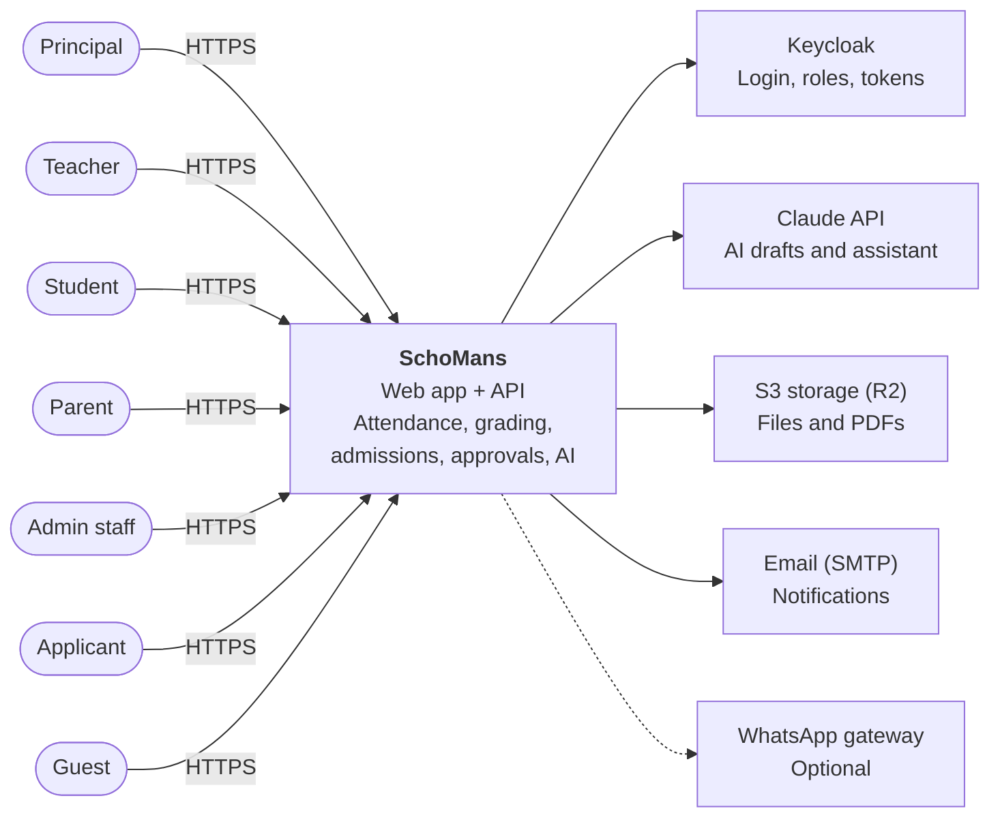

A guest is an anonymous visitor with no account. Registering for admissions creates an account with the Applicant role; when an accepted applicant is enrolled, the role becomes Student.

## 3. Containers & deployment

The reverse proxy is the only public entry point; every other container is reachable only on the internal Docker network.

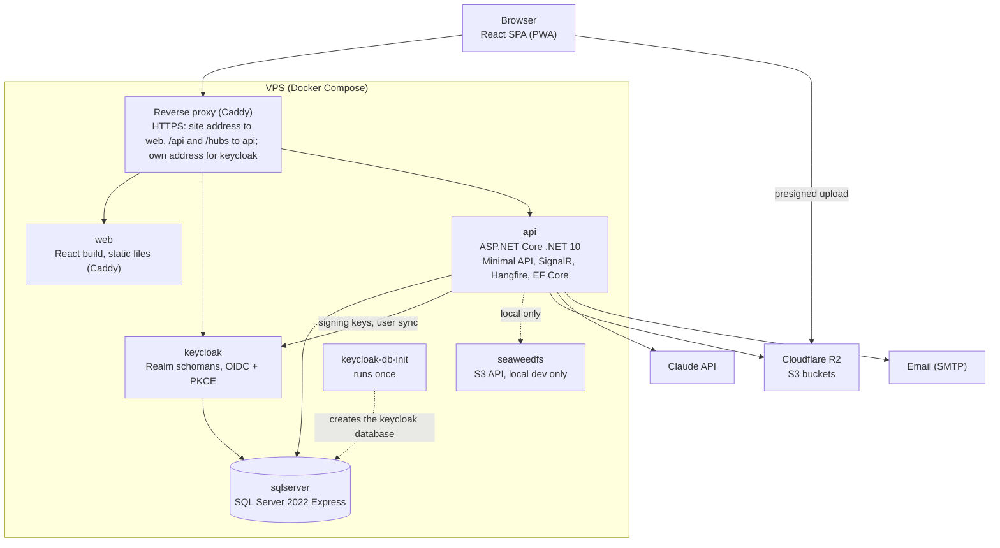

The api validates tokens against Keycloak's signing keys (fetched over the internal network, while the tokens are issued for the public address), writes to SQL Server, and calls the three cloud services; browsers upload large files straight to R2 with presigned URLs. SeaweedFS replaces R2 only in local development. Keycloak keeps its data in a second database of the same SQL Server. Caddy sends the client address in `X-Forwarded-For`, and the api believes it only from the Docker network (`ForwardedHeaders` settings), so the rate limits per address see each visitor. The jobs dashboard (`/hangfire`) and the admin console of Keycloak are not routed to the internet. The files and the steps are in the [deployment guide](deployment.md) (`infra/docker-compose.prod.yml`).

| Container | Image | Resources (approx.) | Persistent volume |
| --- | --- | --- | --- |
| proxy | caddy | 64 MB | TLS certificates |
| web | caddy serving the Vite build (single-page fallback, long cache for hashed files) | 32 MB | — |
| api | .NET 10 ASP.NET Core runtime | 300–500 MB | — |
| sqlserver | mssql/server 2022, `MSSQL_PID=Express` | 2 GB | Database files |
| keycloak | quay.io/keycloak | 0.7–1 GB | Its database in SQL Server; the realm is imported at start |
| seaweedfs | chrislusf/seaweedfs (local only) | 256 MB | Object data |

Resource figures are planning estimates; measure them on the demo server and adjust. The server needs about 4 GB of RAM.

## 4. Application layers

The API follows Clean Architecture with vertical slices; the full layer diagram, folder layout, ADR-001 (no mediator), ADR-002 (Minimal API), and endpoint conventions live in PRD · English, section 7.

| Layer | Responsibility | May depend on |
| --- | --- | --- |
| Domain | Entities, value objects, status transitions, business rules | Nothing |
| Application | One folder per use case (command/query, handler, validator), interfaces for external services, `Result<T>` | Domain |
| Infrastructure | EF Core, S3, Claude, QuestPDF, ClosedXML, Hangfire jobs, Keycloak user sync | Application, Domain |
| Api | Minimal API endpoints, SignalR hubs, authentication, middleware | Application, Infrastructure (DI wiring only) |

## 5. Data model

One SQL Server database, code-first with EF Core. The diagrams below are **generated from the EF Core model** (`AppDbContext`) by `tools/SchoMans.DocGen`, one per domain (the namespace of the entity); the whole model in one diagram is `diagrams/erd.mmd`. Every entity also carries `Id`, `CreatedAt`, `UpdatedAt`, `IsDeleted` (soft delete, filtered globally) and `RowVersion` (optimistic concurrency), which the diagrams leave out. An entity of another domain appears only as the end of a relation. The PRD (section 6) says why the entities exist; `GradeComponent` is an enum (Assignment, Quiz, Midterm, Final), not a table.

<!-- docgen:data-model:start -->

### Admissions

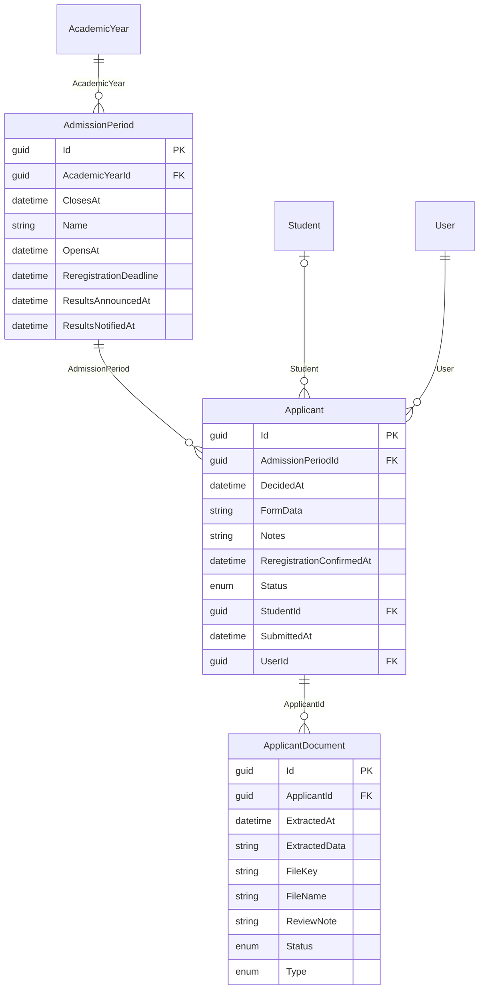

### Ai

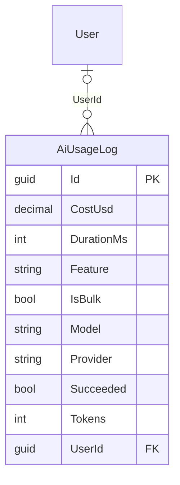

### Approvals

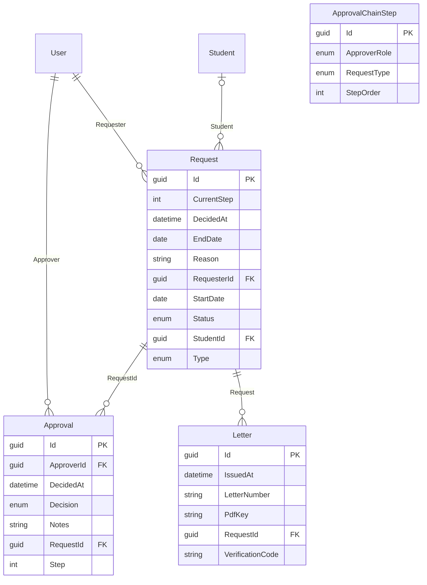

### Assignments

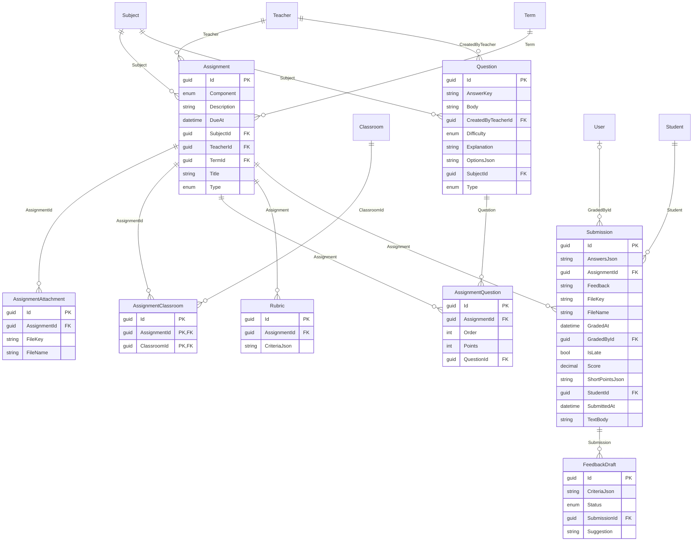

### Attendance

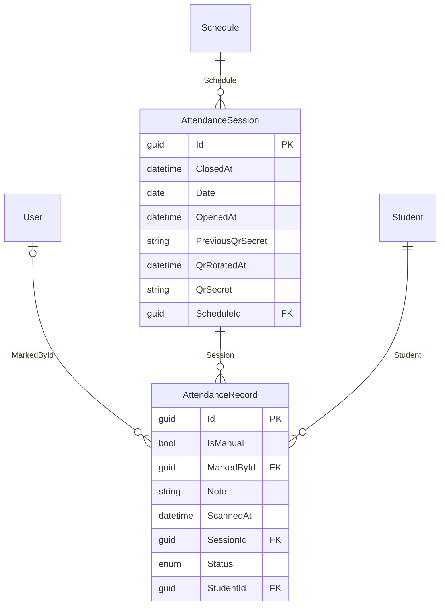

### Audit

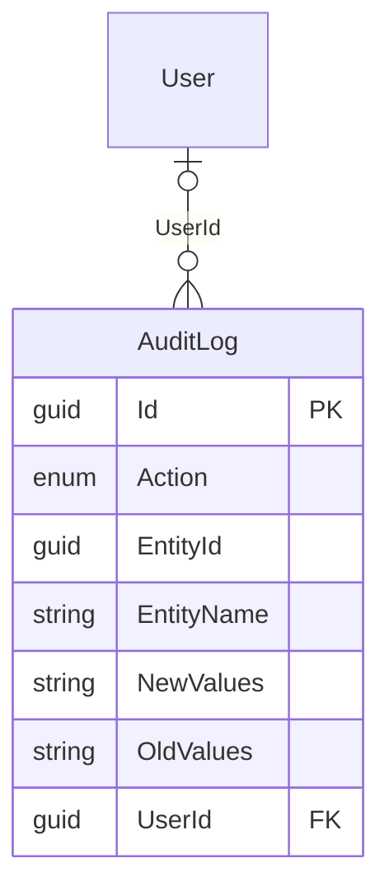

### Communication

```mermaid
erDiagram
  User ||--o{ Announcement : "CreatedById"
  Announcement ||--o{ AnnouncementRead : "AnnouncementId"
  User ||--o{ AnnouncementRead : "UserId"
  User |o--o{ EmailMessage : "UserId"
  User ||--o{ GeneralLetter : "IssuedByUserId"
  User ||--o{ Notification : "UserId"
  User |o--o{ ProgressSummary : "ApprovedById"
  Student ||--o{ ProgressSummary : "Student"
  Announcement {
    guid Id PK
    string Body
    string CoverImageKey
    guid CreatedById FK
    bool IsPublic
    datetime PublishedAt
    enum Status
    list`1 TargetClassroomIds
    list`1 TargetRoles
    string Title
  }
  AnnouncementRead {
    guid Id PK
    guid AnnouncementId FK
    datetime ReadAt
    guid UserId FK
  }
  EmailMessage {
    guid Id PK
    int Attempts
    string Body
    string LastError
    string LinkUrl
    datetime SentAt
    enum Status
    string Subject
    string ToAddress
    guid UserId FK
  }
  GeneralLetter {
    guid Id PK
    string Body
    datetime IssuedAt
    guid IssuedByUserId FK
    enum Kind
    string LetterNumber
    string PdfKey
    string Recipient
    string SignedByName
    string Subject
  }
  NewsArticle {
    guid Id PK
    string Body
    enum Category
    string CoverImageKey
    string MetaDescription
    datetime PublishedAt
    string Slug
    enum Status
    string Title
  }
  Notification {
    guid Id PK
    string Body
    string LinkUrl
    datetime ReadAt
    string Title
    enum Type
    guid UserId FK
  }
  ProgressSummary {
    guid Id PK
    guid ApprovedById FK
    string Body
    bool IsAiDrafted
    string Month
    datetime SentAt
    enum Status
    guid StudentId FK
  }
```

### Grading

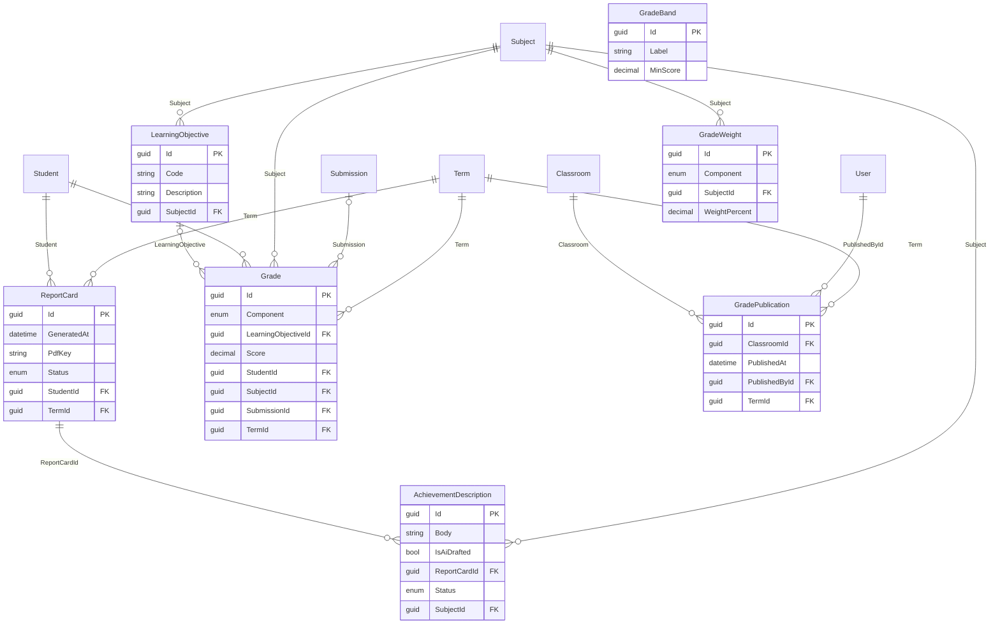

### Students

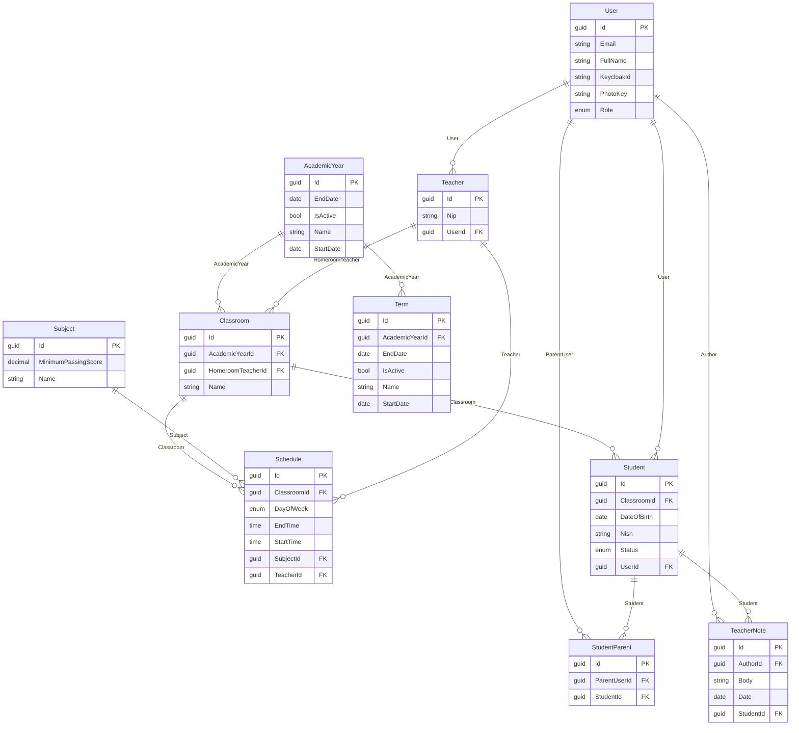

<!-- docgen:data-model:end -->

## 6. Key flows

**Login (OIDC Authorization Code + PKCE)**

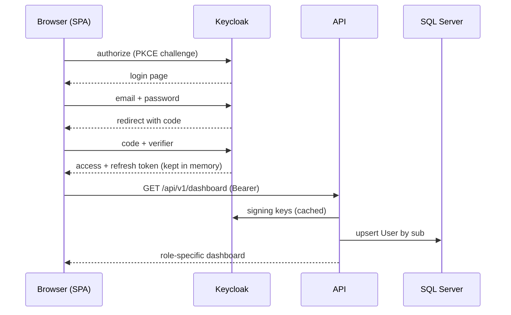

The browser never sees a client secret; the API never sees a password. On the first call the API creates or updates the User row from the token's `sub`, email, and role.

**QR attendance**

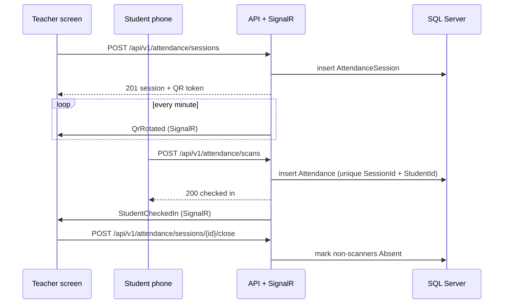

The QR token is a short-lived signed value tied to the session; scans with a secret older than the 10-second grace after a rotation or after the session closes are rejected with ProblemDetails code `attendance.qr_expired`.

**File upload with presigned URL**

1. Browser calls `POST /api/v1/files/upload-url` with module, entity id, file name, type, and size
2. API checks the role and ownership, validates type and size, and returns a presigned PUT URL plus the object key (valid 5 minutes)
3. Browser uploads the file directly to S3
4. Browser calls the feature endpoint (for example submit assignment) with the object key
5. API confirms the object exists, then saves the key on the entity

**AI request (for example AI-01 progress summary)**

1. A background job or a user action builds the input from the database, replacing student names with IDs
2. `ClaudeAiService` checks the user's daily limit and the monthly budget, then calls the Claude API with a cached system prompt
3. The JSON response is validated against its schema; invalid output is retried once, then reported as a failure
4. The result is saved as a Draft, names are mapped back, and `AiDraftReady` is pushed to the reviewer
5. Only after a teacher or staff member approves is the draft published or sent; every call is written to AiUsageLog

## 7. API design

REST over HTTPS, JSON only, versioned under `/api/v1`, one endpoint group per feature (ADR-002). The groups below are read from the endpoints the API registers; every operation, with its method, route, policy, request and response, is in the generated [API reference](generated/api-reference.md), and the interactive reference (Scalar) is at `/scalar` in the Development and Demo environments. The TypeScript client is generated from the OpenAPI document with orval for the first phases; the endpoints of Phase 4 onward still have a hand-written client.

<!-- docgen:api-groups:start -->

| Group | Base path | Operations | Roles (any operation) |
| --- | --- | ---: | --- |
| AcademicYears | `/api/v1/academic-years` | 6 | Principal, Teacher, Admin |
| Admissions | `/api/v1/admissions` | 22 | anonymous and signed-in users |
| Announcements | `/api/v1/announcements` | 11 | anonymous and signed-in users |
| Approval chains | `/api/v1/approval-chains` | 2 | Principal, Admin |
| Assignments | `/api/v1/assignments` | 16 | Principal, Teacher, Student, Parent, Admin, Applicant |
| Attendance | `/api/v1/attendance` | 11 | Principal, Teacher, Student, Parent, Admin, Applicant |
| Audit log | `/api/v1/audit-logs` | 1 | Principal, Admin |
| Chatbot | `/api/v1/chatbot` | 2 | anonymous and signed-in users |
| Classrooms | `/api/v1/classrooms` | 5 | Principal, Teacher, Admin |
| Dashboard | `/api/v1/dashboard` | 2 | Principal, Teacher, Student, Parent, Admin, Applicant |
| Document drafts | `/api/v1/drafts` | 1 | Principal, Admin |
| Essay feedback | `/api/v1/essay-feedback` | 6 | Teacher |
| Files | `/api/v1/files/upload-url` | 1 | Principal, Admin |
| General letters | `/api/v1/general-letters` | 3 | Principal, Admin |
| Grade bands | `/api/v1/grade-bands` | 2 | Principal, Teacher, Student, Parent, Admin, Applicant |
| Grade weights | `/api/v1/grade-weights/{subjectId:guid}` | 2 | Principal, Teacher, Admin |
| Grades | `/api/v1/grades` | 4 | Principal, Teacher |
| Learning objectives | `/api/v1/learning-objectives` | 4 | Teacher |
| Letters | `/api/v1/letters` | 2 | anonymous and signed-in users |
| News | `/api/v1/news` | 9 | anonymous and signed-in users |
| Notifications | `/api/v1/notifications` | 4 | Principal, Teacher, Student, Parent, Admin, Applicant |
| Principal assistant | `/api/v1/assistant/ask` | 1 | Principal |
| Progress summaries | `/api/v1/progress-summaries` | 6 | Teacher, Parent |
| Question bank | `/api/v1/question-bank` | 5 | Teacher |
| Quizzes | `/api/v1/quizzes` | 4 | Principal, Teacher, Student, Parent, Admin, Applicant |
| Report cards | `/api/v1/report-cards` | 8 | Principal, Teacher, Student, Parent, Admin, Applicant |
| Requests | `/api/v1/requests` | 7 | Principal, Teacher, Student, Parent, Admin |
| Rubrics | `/api/v1/rubrics/{assignmentId:guid}` | 2 | Teacher |
| Schedules | `/api/v1/schedules` | 4 | Principal, Teacher, Admin |
| Students | `/api/v1/students` | 7 | Principal, Teacher, Admin |
| Subjects | `/api/v1/subjects` | 5 | Principal, Teacher, Admin |
| Teacher notes | `/api/v1/teacher-notes` | 4 | Teacher |
| Teachers | `/api/v1/teachers` | 5 | Principal, Admin |
| Users | `/api/v1/users/me` | 2 | Principal, Teacher, Student, Parent, Admin, Applicant |
| hubs | `/hubs` | 4 | Principal, Teacher, Student, Parent, Admin, Applicant |
| sitemap.xml | `/sitemap.xml` | 1 | anonymous and signed-in users |

<!-- docgen:api-groups:end -->

**Errors:** RFC 9457 ProblemDetails everywhere, with a stable `code` field (for example `attendance.session_closed`). **Pagination:** `page`, `pageSize` (max 100) → `PagedResult<T>`. **Idempotency:** QR scans are idempotent per session + student.

## 8. Security & authorization

Authentication is OIDC Authorization Code + PKCE against Keycloak; the SPA keeps tokens in memory and the API validates JWT bearer tokens. Authorization has two layers: a role policy on every endpoint, then a data-ownership check in the Application layer.

| Capability | Principal | Teacher | Student | Parent | Admin | Applicant | Guest |
| --- | --- | --- | --- | --- | --- | --- | --- |
| Master data | Read | Read own classes | — | — | Full | — | — |
| Open/close attendance session | — | Own schedule | — | — | — | — | — |
| Scan attendance QR | — | — | Own | — | — | — | — |
| Attendance summaries | All | Own classes | Own | Own child | All | — | — |
| Assignments | Read | Own subjects | Own classes | Own child (read) | — | — | — |
| Grades & report cards | All | Own subjects | Own (published) | Own child (published) | All | — | — |
| Announcements | Create, read | Read | Read | Read | Create, read | Public news and public announcements | Public news and public announcements |
| Admissions | Read | — | — | — | Verify, announce | Own application | Start registration |
| Requests & approvals | Approve | Submit, approve as homeroom | — | Submit for own child | Read | — | — |
| AI features | Assistant (AI-04) | AI-02, AI-05, AI-06 | — | Read AI-01 summaries | AI-03, AI-09 | Chatbot (AI-08), AI-03 on own documents | Chatbot (AI-08) |

**Other controls:** rate limiting on login, public chatbot, and uploads; file type and size validation before issuing upload URLs; HTTPS only behind the reverse proxy; secrets in environment variables, never in the repo; audit log for grade, attendance, and approval changes; student names pseudonymized before AI calls.

## 9. Real-time events & background jobs

Read from the code by `tools/SchoMans.DocGen`: the SignalR hubs (authenticated with the same JWT; clients join groups by user, classroom or session) with the events they send, and the recurring Hangfire jobs with SQL Server storage with their schedules. The same text is in [generated/jobs-and-realtime.md](generated/jobs-and-realtime.md).

<!-- docgen:jobs-and-realtime:start -->

### Recurring jobs (Hangfire)

Registered once at start-up by `JobsSetup.RegisterRecurringJobs`; the jobs dashboard is `/hangfire` (admin staff and the principal, not routed on the public internet).

| Id | Job | Schedule (cron) | Time zone |
| --- | --- | --- | --- |
| `rotate-attendance-qr` | RotateAttendanceQrJob | `* * * * *` | UTC |
| `close-stale-attendance-sessions` | CloseStaleSessionsJob | `*/15 * * * *` | UTC |
| `admission-results` | AdmissionResultsJob | `*/5 * * * *` | UTC |
| `send-queued-emails` | SendQueuedEmailsJob | `* * * * *` | UTC |
| `progress-summary-drafts` | ProgressSummaryDraftJob | `0 6 1-3 * *` | Asia/Jakarta |
| `assignment-due-reminder` | AssignmentDueReminderJob | `0 7 * * *` | Asia/Jakarta |

### SignalR hubs

Both hubs need a signed-in user (the access token is sent as the `access_token` query value of the WebSocket request).

#### AttendanceHub (`/hubs/attendance`)

Events the server sends: `QrRotated`, `SessionClosed`, `StudentCheckedIn`.

Methods the client may call: `JoinSession(Guid sessionId)`, `LeaveSession(Guid sessionId)`.

#### NotificationHub (`/hubs/notifications`)

Events the server sends: `NotificationCreated`.

Methods the client may call: `OnConnectedAsync()`.

<!-- docgen:jobs-and-realtime:end -->

## 10. File storage

All files live in S3-compatible storage behind `IFileStorage`: SeaweedFS locally, Cloudflare R2 in the live demo. The database stores object keys, never URLs.

| Bucket | Access | Contents | Key pattern |
| --- | --- | --- | --- |
| `schomans-private` | Presigned URLs only (5-minute expiry) | Assignment submissions, admission documents, report-card and letter PDFs | `{module}/{academic-year}/{entity-id}/{guid}.{ext}` |
| `schomans-public` | Public read | News cover images, school logo | `news/{article-id}/{guid}.{ext}` |

Uploads: the browser asks the API for a presigned PUT URL, the API validates type and size and checks permissions, the browser uploads directly, and the API confirms the object exists before saving its key. Downloads: the API checks permissions and returns a short-lived presigned GET URL.

## 11. Observability & operations

| Concern | Approach |
| --- | --- |
| Logging | Serilog structured logs with correlation id per request, shipped to Seq |
| Audit | `SaveChangesInterceptor` writes AuditLog rows (user, action, old and new values) for grades, attendance records, requests, and approval steps in the same save as the change; admin staff and the principal read them at `GET /api/v1/audit-logs` |
| Email | Handlers queue an `EmailMessage` next to the in-app notification (request decided, admission result, announcement published, progress summary sent); a Hangfire job sends the queue every minute over SMTP (Mailpit locally), retries 5 times, then marks the mail Failed |
| PWA | `manifest.webmanifest` with PNG icons makes the app installable; a hand-written service worker (`web/public/sw.js`, production builds only) caches the app shell and the hashed build assets, never the API or Keycloak, so the installed app opens offline but all data stays live |
| Health | `/health/live` and `/health/ready` (SQL Server, Keycloak, S3) used by Docker and the reverse proxy |
| AI usage | Every Claude call logged with feature, user, tokens, cost, and duration; monthly budget cap |
| Backups | Planned: a nightly SQL Server backup to the private bucket with 14-day retention. **Not built**: today the database is a Docker volume, and the [deployment guide](deployment.md) says how to take a manual backup. |
| Configuration | Environment variables per environment (local, demo); realm exported as JSON and imported on startup |
| CI/CD | GitHub Actions: build, tests with Testcontainers, coverage, Playwright E2E, Docker images, deploy on release tag |

## 12. Keeping this document up to date

The source of truth is the repository. Everything that can be derived from the code is written by the console app `tools/SchoMans.DocGen`, which builds the API the way `Program.cs` does (the endpoint list is `EndpointRegistration.MapSchoMansEndpoints`) with settings that point nowhere, so it needs no database and no network. Run it with `dotnet run --project tools/SchoMans.DocGen`; with `--check` it writes nothing and fails when a file is out of date.

| Artifact | Generated from | Output |
| --- | --- | --- |
| ERD | EF Core model (`AppDbContext`, `DbContext.Model`) | `docs/en/diagrams/erd.mmd` (whole model), and one diagram per domain in section 5 |
| API reference | The endpoints the API registers (route, method, name, policy, request and response types, rate limit) | `docs/en/generated/api-reference.md`, and the groups table in section 7 |
| Authorization matrix | The policies registered on the endpoints, resolved to roles | `docs/en/generated/authorization-matrix.md` |
| Recurring jobs | The real registration in `JobsSetup.RegisterRecurringJobs`, run against a stand-in job manager | `docs/en/generated/jobs-and-realtime.md`, and section 9 |
| SignalR hubs and events | The hub classes and their constants | `docs/en/generated/jobs-and-realtime.md`, and section 9 |
| Context, container and layer diagrams | Hand-written Mermaid | `docs/en/diagrams/*.mmd`, rendered by GitHub |
| Sequence diagrams | Hand-written Mermaid | `docs/en/diagrams/sequences/*.mmd` |

Parts of this file between `docgen:*:start` and `docgen:*:end` markers are written by the tool; everything else is hand-written. With `--check` the tool also reads the hand-written diagrams and this file, and fails when one names an API route or hub (`/api/v1/...`, `/hubs/...`) that no longer exists.

The `docs.yml` workflow runs the tool on every merge to `main` and on a release tag: it fails if a hand-written document names a route that is gone, and opens a pull request when a generated file changed. The OpenAPI document itself is served by the running API (`/openapi/v1.json`, in the Development and Demo environments); the TypeScript client is generated from it with orval for the endpoints of the first three phases, and hand-written for the later ones.
