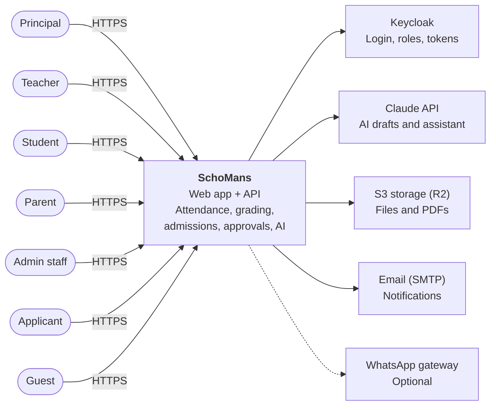
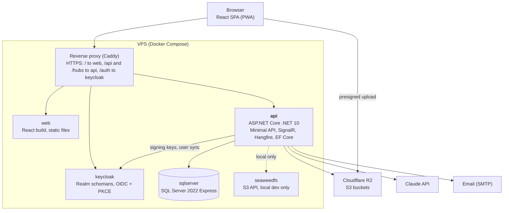
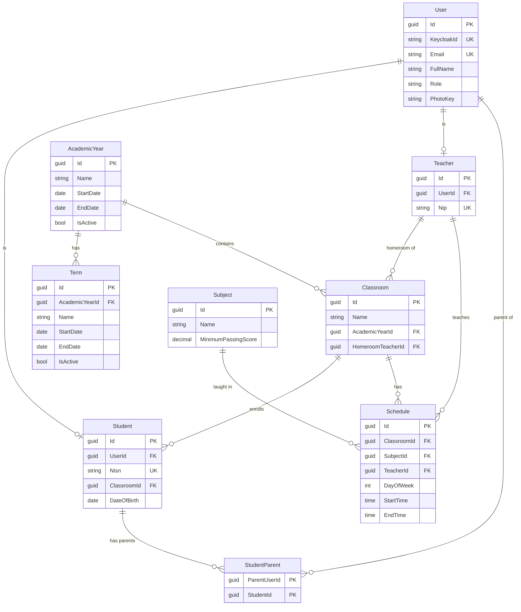
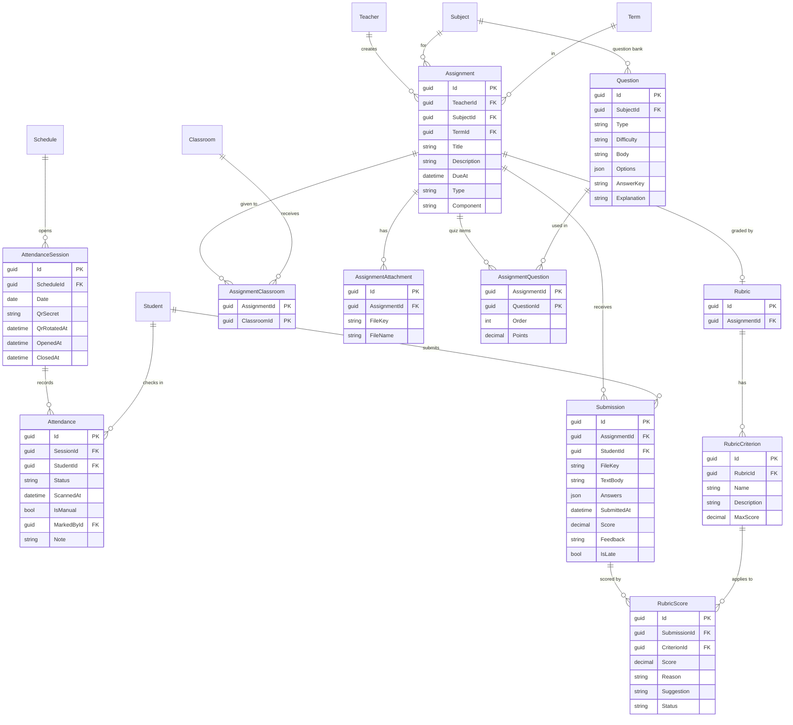
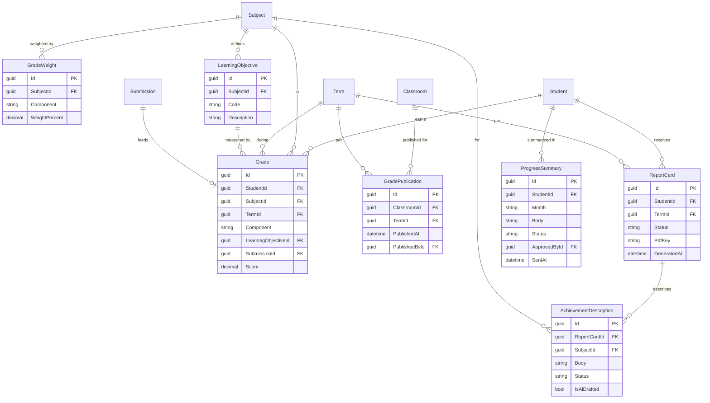
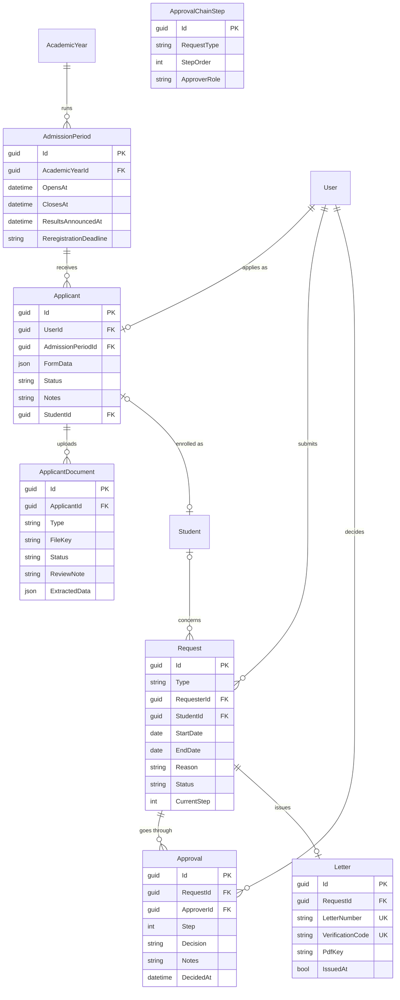
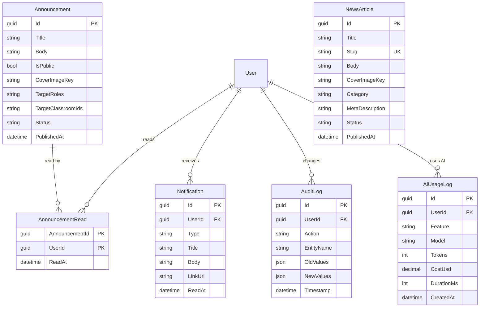
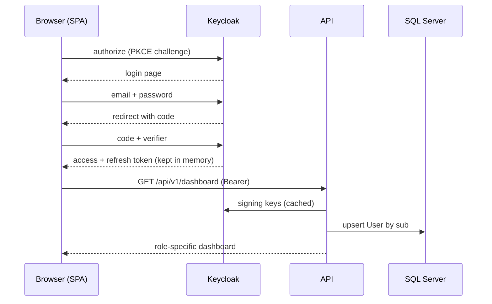
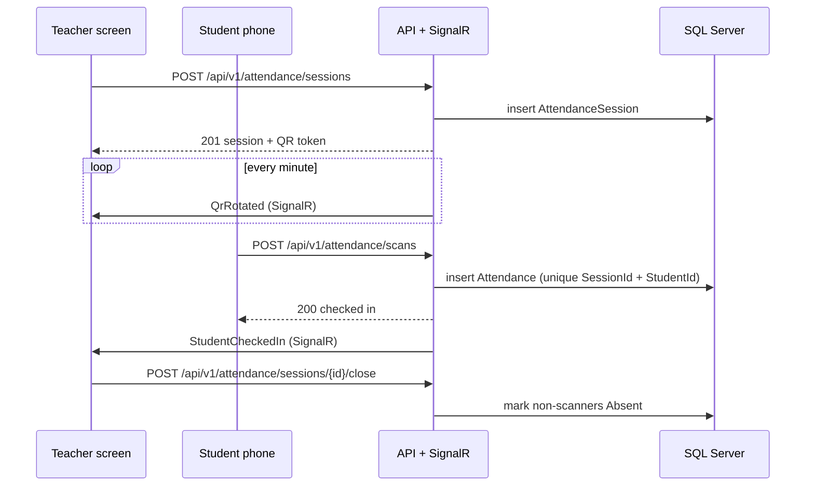

# SchoMans System Design

Oct 23, 2026 · @M Ridhwan Habib A

SchoMans is a modular monolith: one ASP.NET Core API and one React SPA, backed by SQL Server, Keycloak, S3-compatible storage, and the Claude API, deployed with Docker Compose on a single VPS. This document describes the system as designed in the PRD and is regenerated from the repository on the final-phase deploy (section 12).

## 1. Scope & quality goals

The design optimizes for a single school (up to 1,500 students and 100 teachers) run by one developer on one server, while keeping boundaries clean enough to split later.

| Quality goal | Target | Design response |
| --- | --- | --- |
| Responsiveness | QR scan recorded < 3 s; announcements delivered < 5 s | SignalR push, indexed lookups, idempotent scan writes |
| Security & privacy | Children's data visible only to authorized roles | Keycloak OIDC, policy per endpoint, ownership checks in Application, private S3 bucket |
| Testability | Coverage ≥ 70%, every endpoint has integration tests | Clean Architecture, external services behind interfaces, Testcontainers |
| Operability | One-command local setup and deploy | Docker Compose, realm export, seeded demo data, health checks |
| Cost | Free software; only hosting and Claude API are paid | Open-source stack, AI budget caps, mock mode |
| Evolvability | Add features or locales without rewiring | Vertical slices, i18n, multi-tenant-ready schema |

**Architecture style:** modular monolith. One deployable API keeps operations simple for a solo developer; feature folders and interfaces keep module boundaries explicit.

## 2. System context

Every role reaches SchoMans through a browser or the installed PWA; SchoMans delegates identity to Keycloak, AI to the Claude API, files to S3-compatible storage, and notifications to email (WhatsApp is optional).

A guest is an anonymous visitor with no account. Registering for admissions creates an account with the Applicant role; when an accepted applicant is enrolled, the role becomes Student.

## 3. Containers & deployment

The reverse proxy is the only public entry point; every other container is reachable only on the internal Docker network.

The api validates tokens against Keycloak's signing keys, writes to SQL Server, and calls the three cloud services; browsers upload large files straight to R2 with presigned URLs. SeaweedFS replaces R2 only in local development.

| Container | Image | Resources (approx.) | Persistent volume |
| --- | --- | --- | --- |
| proxy | caddy | 64 MB | TLS certificates |
| web | nginx serving the Vite build | 32 MB | — |
| api | .NET 10 ASP.NET Core runtime | 300–500 MB | — |
| sqlserver | mssql/server 2022, `MSSQL_PID=Express` | 2 GB | Database files |
| keycloak | quay.io/keycloak | 0.7–1 GB | Realm export (imported at start) |
| seaweedfs | chrislusf/seaweedfs (local only) | 256 MB | Object data |

Resource figures are planning estimates; measure them on the demo server and adjust.

## 4. Application layers

The API follows Clean Architecture with vertical slices; the full layer diagram, folder layout, ADR-001 (no mediator), ADR-002 (Minimal API), and endpoint conventions live in PRD · English, section 7.

| Layer | Responsibility | May depend on |
| --- | --- | --- |
| Domain | Entities, value objects, status transitions, business rules | Nothing |
| Application | One folder per use case (command/query, handler, validator), interfaces for external services, `Result<T>` | Domain |
| Infrastructure | EF Core, S3, Claude, QuestPDF, ClosedXML, Hangfire jobs, Keycloak user sync | Application, Domain |
| Api | Minimal API endpoints, SignalR hubs, authentication, middleware | Application, Infrastructure (DI wiring only) |

## 5. Data model

One SQL Server database, code-first with EF Core. The model is split into five ERDs by domain; every entity also carries `CreatedAt`, `UpdatedAt`, `IsDeleted` (soft delete, filtered globally), and `RowVersion` (optimistic concurrency), which are left out of the diagrams. The data model in PRD · English section 6 is the reference; `GradeComponent` is an enum (Assignment, Quiz, Midterm, Final), not a table.

A parent is a User linked to one or more students through StudentParent; a classroom belongs to one academic year and has one homeroom teacher; terms belong to an academic year.

An assignment can be given to several classrooms (AssignmentClassroom). Quiz assignments pull items from the subject's question bank through AssignmentQuestion. The unique constraint on Attendance (SessionId + StudentId) makes a double scan harmless: the second insert is rejected and the API returns the existing record.

Grade weights are per subject and component and add up to 100. A GradePublication row per classroom and term is what makes grades visible to students and parents. A graded submission creates its Grade row automatically (Grade.SubmissionId).

ApprovalChainStep holds the configurable chain per request type (for example homeroom teacher, then principal); Request.CurrentStep points at the step awaiting a decision. When an accepted applicant is enrolled, a Student is created and Applicant.StudentId is set.

NewsArticle is public (landing page and a source for the AI-08 chatbot); Announcement is internal by default and targeted by role or classroom; IsPublic also shows a specific announcement to guests. Notification backs the in-app unread badge for every event type, AnnouncementRead tracks which announcements a user has opened.

**Key constraints & indexes**

| Table | Constraint or index | Why |
| --- | --- | --- |
| Attendance | Unique (SessionId, StudentId) | Idempotent QR scans |
| Student | Unique Nisn; unique UserId | One record per student and per account |
| User | Unique KeycloakId; unique Email | Sync by Keycloak `sub` on first login |
| Grade | Index (StudentId, TermId) | Report-card and dashboard queries |
| Submission | Unique (AssignmentId, StudentId) | One submission per student per assignment |
| AttendanceSession | Index (ScheduleId, Date) | Today's sessions per teacher |
| AnnouncementRead | Primary key (AnnouncementId, UserId) | Unread counts |
| AuditLog | Index (EntityName, Timestamp) | Audit lookups; append-only |
| Term | Index (AcademicYearId, IsActive) | Current term lookups |
| GradeWeight | Unique (SubjectId, Component) | One weight per component per subject |
| GradePublication | Unique (ClassroomId, TermId) | Grades published once per classroom and term |
| ReportCard | Unique (StudentId, TermId) | One report card per student and term |
| Grade | Unique SubmissionId (where not null) | An assignment score feeds one grade row |
| NewsArticle | Unique Slug | SEO-friendly URLs |
| Letter | Unique LetterNumber; unique VerificationCode | Authenticity check by QR |
| Notification | Index (UserId, ReadAt) | Unread badge |
| All entities | Global query filter on IsDeleted; RowVersion | Soft delete and optimistic concurrency |

## 6. Key flows

**Login (OIDC Authorization Code + PKCE)**

The browser never sees a client secret; the API never sees a password. On the first call the API creates or updates the User row from the token's `sub`, email, and role.

**QR attendance**

The QR token is a short-lived signed value tied to the session; scans with a secret older than the 10-second grace after a rotation or after the session closes are rejected with ProblemDetails code `attendance.qr_expired`.

**File upload with presigned URL**

1. Browser calls `POST /api/v1/files/upload-url` with module, entity id, file name, type, and size
2. API checks the role and ownership, validates type and size, and returns a presigned PUT URL plus the object key (valid 5 minutes)
3. Browser uploads the file directly to S3
4. Browser calls the feature endpoint (for example submit assignment) with the object key
5. API confirms the object exists, then saves the key on the entity

**AI request (for example AI-01 progress summary)**

1. A background job or a user action builds the input from the database, replacing student names with IDs
2. `ClaudeAiService` checks the user's daily limit and the monthly budget, then calls the Claude API with a cached system prompt
3. The JSON response is validated against its schema; invalid output is retried once, then reported as a failure
4. The result is saved as a Draft, names are mapped back, and `AiDraftReady` is pushed to the reviewer
5. Only after a teacher or staff member approves is the draft published or sent; every call is written to AiUsageLog

## 7. API design

REST over HTTPS, JSON only, versioned under `/api/v1`, one endpoint group per feature. The OpenAPI document is the contract; the TypeScript client is generated from it with orval.

| Group | Base path | Main endpoints | Roles |
| --- | --- | --- | --- |
| Students | `/api/v1/students` | list, get, create, update, delete, `POST /import` | Admin (write), Teacher (read own classes) |
| Teachers | `/api/v1/teachers` | list, get, create, update, delete | Admin |
| Classrooms & subjects | `/api/v1/classrooms`, `/api/v1/subjects` | CRUD, promote academic year | Admin |
| Attendance | `/api/v1/attendance` | `POST /sessions`, `POST /scans`, `POST /sessions/{id}/close`, `GET /summary` | Teacher, Student |
| Assignments | `/api/v1/assignments` | CRUD, `POST /{id}/submissions`, `PUT /submissions/{id}/score` | Teacher, Student |
| Grades & report cards | `/api/v1/grades`, `/api/v1/report-cards` | enter, publish, `GET /{id}/pdf` | Teacher, Student, Parent |
| Announcements & news | `/api/v1/announcements`, `/api/v1/news` | CRUD, mark read; public news is anonymous | Admin, all |
| Admissions | `/api/v1/admissions` | apply, upload documents, verify, announce results | Applicant, Admin |
| Requests & approvals | `/api/v1/requests` | submit, `POST /{id}/approve`, `POST /{id}/reject` | Parent, Teacher, Principal |
| Files | `/api/v1/files` | `POST /upload-url`, `GET /{key}/download-url` | Per owning feature |
| AI | `/api/v1/ai` | progress summaries, report descriptions, document extraction, assistant, quiz generation, chatbot | Per feature |
| Dashboard | `/api/v1/dashboard` | role-specific summaries | All signed-in roles |

**Errors:** RFC 9457 ProblemDetails everywhere, with a stable `code` field (for example `attendance.session_closed`). **Pagination:** `page`, `pageSize` (max 100) → `PagedResult<T>`. **Idempotency:** QR scans are idempotent per session + student.

## 8. Security & authorization

Authentication is OIDC Authorization Code + PKCE against Keycloak; the SPA keeps tokens in memory and the API validates JWT bearer tokens. Authorization has two layers: a role policy on every endpoint, then a data-ownership check in the Application layer.

| Capability | Principal | Teacher | Student | Parent | Admin | Applicant | Guest |
| --- | --- | --- | --- | --- | --- | --- | --- |
| Master data | Read | Read own classes | — | — | Full | — | — |
| Open/close attendance session | — | Own schedule | — | — | — | — | — |
| Scan attendance QR | — | — | Own | — | — | — | — |
| Attendance summaries | All | Own classes | Own | Own child | All | — | — |
| Assignments | Read | Own subjects | Own classes | Own child (read) | — | — | — |
| Grades & report cards | All | Own subjects | Own (published) | Own child (published) | All | — | — |
| Announcements | Create, read | Read | Read | Read | Create, read | Public news and public announcements | Public news and public announcements |
| Admissions | Read | — | — | — | Verify, announce | Own application | Start registration |
| Requests & approvals | Approve | Submit, approve as homeroom | — | Submit for own child | Read | — | — |
| AI features | Assistant (AI-04) | AI-02, AI-05, AI-06 | — | Read AI-01 summaries | AI-03, AI-09 | Chatbot (AI-08), AI-03 on own documents | Chatbot (AI-08) |

**Other controls:** rate limiting on login, public chatbot, and uploads; file type and size validation before issuing upload URLs; HTTPS only behind the reverse proxy; secrets in environment variables, never in the repo; audit log for grade, attendance, and approval changes; student names pseudonymized before AI calls.

## 9. Real-time events & background jobs

**SignalR hubs** (authenticated with the same JWT; clients join groups by role, classroom, or session):

| Hub | Event | Sent to | Frontend reaction |
| --- | --- | --- | --- |
| AttendanceHub | `StudentCheckedIn` | Group `session:{id}` | Invalidate the live attendance query |
| AttendanceHub | `QrRotated` | Group `session:{id}` (teacher screen) | Show the new QR code |
| AttendanceHub | `SessionClosed` | Group `session:{id}` | Show the final list |
| NotificationHub | `NotificationCreated` | User or role group | Increment unread badge, show toast |
| NotificationHub | `AiDraftReady` | Requesting user | Open the reviewed draft |

**Background jobs** (Hangfire with SQL Server storage):

| Job | Schedule | Purpose |
| --- | --- | --- |
| RotateAttendanceQr | Recurring, every minute | Issue a new QR secret for every open session and push `QrRotated` |
| CloseStaleSessions | Every 15 min | Close sessions left open and mark non-scanners absent |
| AssignmentDueReminder | Daily 07:00 WIB | Notify students one day before due dates |
| DraftProgressSummaries | 1st of each month, 02:00 WIB | Draft AI-01 summaries for homeroom review |
| PublishAdmissionResults | At the configured date and time | Announce admission results simultaneously |
| PurgeRejectedApplicantFiles | Daily after the admission period | Delete documents of rejected applicants |

## 10. File storage

All files live in S3-compatible storage behind `IFileStorage`: SeaweedFS locally, Cloudflare R2 in the live demo. The database stores object keys, never URLs.

| Bucket | Access | Contents | Key pattern |
| --- | --- | --- | --- |
| `schomans-private` | Presigned URLs only (5-minute expiry) | Assignment submissions, admission documents, report-card and letter PDFs | `{module}/{academic-year}/{entity-id}/{guid}.{ext}` |
| `schomans-public` | Public read | News cover images, school logo | `news/{article-id}/{guid}.{ext}` |

Uploads: the browser asks the API for a presigned PUT URL, the API validates type and size and checks permissions, the browser uploads directly, and the API confirms the object exists before saving its key. Downloads: the API checks permissions and returns a short-lived presigned GET URL.

## 11. Observability & operations

| Concern | Approach |
| --- | --- |
| Logging | Serilog structured logs with correlation id per request, shipped to Seq |
| Audit | `SaveChangesInterceptor` writes AuditLog rows for grades, attendance, and approvals |
| Health | `/health/live` and `/health/ready` (SQL Server, Keycloak, S3) used by Docker and the reverse proxy |
| AI usage | Every Claude call logged with feature, user, tokens, cost, and duration; monthly budget cap |
| Backups | Nightly SQL Server backup to the private bucket, 14-day retention |
| Configuration | Environment variables per environment (local, demo); realm exported as JSON and imported on startup |
| CI/CD | GitHub Actions: build, tests with Testcontainers, coverage, Playwright E2E, Docker images, deploy on release tag |

## 12. Keeping this document up to date

This tab is the design as planned. The source of truth moves to the repository once code exists: `docs/en/system-design.md` (with an Indonesian copy in `docs/id/`), where every diagram is stored as code and regenerated automatically.

| Artifact | Generated from | Tool | Output |
| --- | --- | --- | --- |
| ERD | EF Core model (`AppDbContext`) | Small console app `tools/SchoMans.DocGen` reading `DbContext.Model` | Mermaid `erDiagram` in `docs/en/diagrams/erd.mmd` |
| API reference | Running API | Built-in OpenAPI export at build time | `docs/en/api/openapi.json` + endpoint table |
| Context, container & deployment diagrams | Hand-written diagrams as code | Mermaid (C4 syntax) | `docs/en/diagrams/*.mmd`, rendered by GitHub |
| Sequence diagrams | Hand-written diagrams as code | Mermaid `sequenceDiagram` | `docs/en/diagrams/sequences/*.mmd` |
| Authorization matrix | Policies registered in code | DocGen reading the policy registry | Table in `system-design.md` |
| Background jobs & SignalR events | Job and hub registrations | DocGen | Tables in `system-design.md` |
| Screenshots | Deployed demo | Playwright `capture:screenshots` | `docs/assets/screenshots/` |

**When it runs:** a `docs.yml` GitHub Actions workflow runs on every merge to `main` and on the release tag of the final phase (Phase 8). It regenerates everything above, fails the build if a hand-written diagram references an entity or endpoint that no longer exists, and opens a pull request with the updated docs. After the Phase 8 deploy, ask Claude to sync this tab from `docs/en/system-design.md` so both match.
