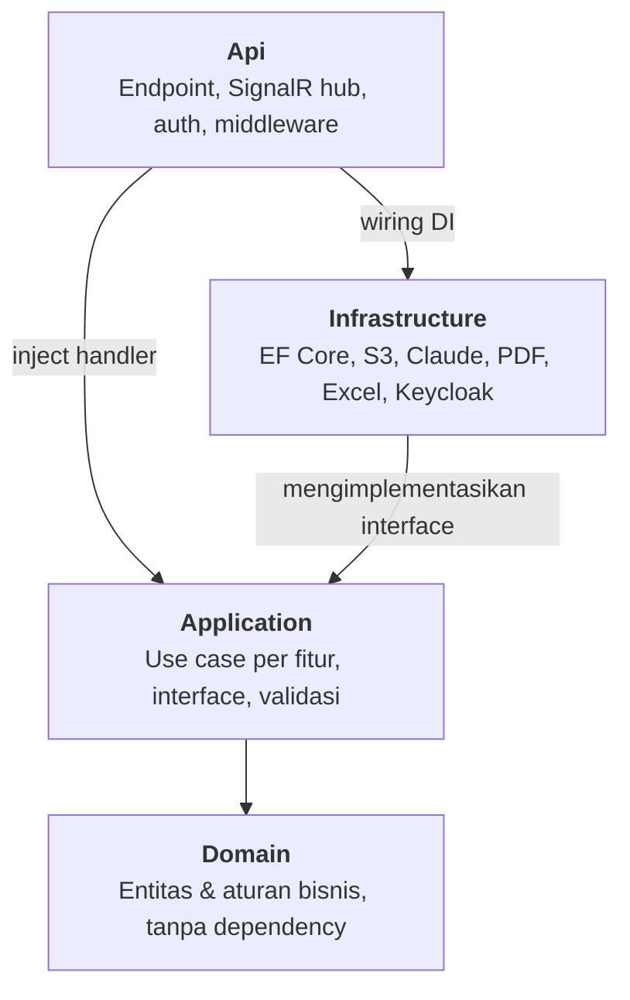

# PRD SchoMans (School Management System)

Oct 23, 2026 · @M Ridhwan Habib A

## Cara pakai template ini

PRD yang bagus untuk Claude itu spesifik, terukur, dan tegas soal apa yang *tidak* dikerjakan. Claude bekerja paling baik kalau setiap fitur punya acceptance criteria yang bisa dicek, bukan deskripsi umum.

1. Isi semua bagian dalam \[kurung siku\]. Kalau belum tahu, tulis di bagian Pertanyaan terbuka, jangan dikosongkan.
2. Minta Claude mereview dulu sebelum ngoding: *"Baca PRD ini. Sebutkan bagian yang ambigu, kontradiktif, atau kurang, lalu ajukan pertanyaan sebelum mulai."*
3. Kerjakan per fase dari bagian Rencana implementasi: *"Kerjakan Fase 1 saja. Berhenti setelah selesai dan tunjukkan cara mengetesnya."*
4. Di Claude Code, simpan PRD sebagai `docs/id/PRD.md` dan rujuk dari `CLAUDE.md`, supaya selalu jadi konteks.
5. Perbarui PRD setiap ada keputusan baru. PRD adalah sumber kebenaran, bukan riwayat chat.

## 1. Ringkasan & masalah

**Nama produk:** SchoMans (School Managemet System)

**Ringkasan satu kalimat:** SchoMans menyatukan penilaian, absensi, PR, PPDB, pengumuman, approval administrasi, serta data siswa dan kelas dalam satu platform untuk guru, siswa, orang tua, dan staf sekolah; ke depan dikembangkan menjadi Learning Management System (LMS).

**Masalah:** Proses sekolah masih manual dan tersebar di kertas, spreadsheet, dan grup WhatsApp. Akibatnya informasi lambat sampai, data nilai dan absensi sulit direkap, dan approval administrasi bisa makan waktu berhari-hari.

**Nilai sebagai portofolio:** proyek ini memamerkan hal yang dicari rekruter fullstack: role-based access control untuk 6 peran, alur approval bertingkat, notifikasi realtime, pembuatan PDF (rapor, kartu pelajar), dashboard analitik, dan integrasi AI. Targetnya: aplikasi live dengan akun demo per peran yang bisa dicoba dalam 2 menit.

## 2. Tujuan, non-tujuan & metrik sukses

**Tujuan**

- Pendataan siswa, guru, dan kelas terpusat dengan import dari Excel
- Berita sekolah dan pengumuman yang tersampaikan realtime ke peran yang dituju
- Pemberian dan pengumpulan PR melalui modul LMS
- PPDB online: pendaftaran, upload berkas, seleksi, dan pengumuman hasil
- Digitalisasi administrasi dengan alur approval (izin, surat, cuti guru)
- Absensi online dengan scan QR dan laporan rekap otomatis
- Penilaian dan rapor digital yang bisa dipantau orang tua

**Non-tujuan (out of scope versi 1).** Batasan ini menjaga proyek tetap selesai dan mencegah Claude menambah fitur yang tidak diminta.

- Aplikasi mobile native; cukup web responsif yang bisa di-install sebagai PWA
- Pembayaran SPP sungguhan; jika dibuat, hanya mode sandbox
- Video conference atau kelas live; tutor AI untuk siswa
- Multi-sekolah (multi-tenant); desain data tetap disiapkan untuk itu

**Metrik sukses**

| Metrik | Target | Cara mengukur |
| --- | --- | --- |
| Absensi QR tercatat di sistem | < 3 detik setelah scan | Tes manual 5 pengguna |
| Pengumuman sampai ke penerima | < 5 detik, realtime | Buka 2 browser, kirim dan amati |
| Approval administrasi | Dari berhari-hari jadi < 1 hari | Simulasi alur dengan akun demo |
| Rekruter mencoba aplikasi | < 2 menit dari landing page ke dashboard | Tombol login demo per peran |
| Kualitas kode | Coverage test ≥ 70%, CI hijau | Laporan GitHub Actions |
| Performa | Skor Lighthouse ≥ 90 | Lighthouse di halaman publik |

## 3. Pengguna & user stories

**Peran pengguna** (masing-masing punya dashboard dan hak akses sendiri):

| Peran | Kebutuhan utama | Perangkat |
| --- | --- | --- |
| Kepala Sekolah | Approval, monitoring presensi dan nilai seluruh sekolah | Laptop, HP |
| Guru (termasuk wali kelas) | Input nilai, beri PR, absensi kelas, ajukan izin | Laptop |
| Siswa | Lihat dan kumpulkan PR, scan QR absensi, lihat nilai | HP |
| Orang tua | Pantau nilai, absensi, dan pengumuman anak | HP |
| Petugas Tata Usaha (Admin) | Kelola data master, PPDB, surat, akun pengguna | Laptop |
| Pendaftar PPDB (Applicant) | Tamu yang sudah mendaftar PPDB: isi formulir, unggah dokumen, pantau status seleksi | HP |
| Tamu umum (Guest) | Pengunjung anonim tanpa akun: baca berita, info PPDB, dan prestasi; pakai chatbot; memulai pendaftaran | HP |

Guest dan Applicant dibedakan: Guest tidak punya akun dan tidak punya peran di Keycloak, sedangkan Applicant punya akun dengan realm role `Applicant` yang diberikan otomatis saat registrasi mandiri. Jadi enam realm role adalah Principal, Teacher, Student, Parent, Admin, dan Applicant. Setelah pendaftar yang diterima resmi terdaftar (F-07), peran akunnya berubah menjadi Student.

Satu orang tua bisa terhubung ke lebih dari satu anak, dan satu guru bisa sekaligus wali kelas.

**User stories**, format: *Sebagai \[peran\], saya ingin \[aksi\], supaya \[manfaat\].*

| ID | User story | Prioritas |
| --- | --- | --- |
| US-01 | Sebagai guru, saya ingin menambah PR dengan lampiran dan tenggat, supaya siswa mendapat info PR dengan mudah | Wajib |
| US-02 | Sebagai siswa, saya ingin melihat daftar tugas dan tenggatnya, supaya mengetahui tugas baru tepat waktu | Wajib |
| US-03 | Sebagai orang tua, saya ingin melihat capaian akademik dan absensi anak, supaya bisa memonitor perkembangannya | Wajib |
| US-04 | Sebagai kepala sekolah, saya ingin menyetujui pengajuan administrasi dan memonitor presensi serta nilai siswa dan guru, supaya bisa memantau kondisi sekolah | Wajib |
| US-05 | Sebagai tamu umum, saya ingin melihat berita sekolah, info PPDB, pengumuman, dan penghargaan, supaya tidak ketinggalan informasi | Wajib |
| US-06 | Sebagai siswa, saya ingin absen dengan scan QR di kelas, supaya kehadiran tercatat tanpa dipanggil satu per satu | Wajib |
| US-07 | Sebagai petugas TU, saya ingin import data siswa dari Excel, supaya tidak input manual ratusan data | Wajib |
| US-08 | Sebagai calon siswa, saya ingin mendaftar PPDB online dan memantau status seleksi, supaya tidak perlu datang ke sekolah | Wajib |
| US-09 | Sebagai guru, saya ingin rapor terbentuk otomatis dari nilai yang diinput, supaya tidak menyusun manual tiap semester | Sebaiknya |
| US-10 | Sebagai guru, saya ingin AI membantu memberi draf umpan balik untuk jawaban esai, supaya koreksi lebih cepat | Sebaiknya |
| US-11 | Sebagai guru, saya ingin draf deskripsi capaian rapor dibuat otomatis dari nilai dan catatan, supaya penyusunan rapor tidak memakan waktu berjam-jam | Sebaiknya |
| US-12 | Sebagai petugas TU, saya ingin data dari foto KK dan akta terbaca otomatis ke formulir PPDB, supaya verifikasi lebih cepat dan minim salah ketik | Sebaiknya |
| US-13 | Sebagai kepala sekolah, saya ingin bertanya tentang kondisi sekolah dengan bahasa biasa, supaya tidak perlu membuka banyak laporan | Sebaiknya |
| US-14 | Sebagai orang tua, saya ingin ringkasan perkembangan anak setiap bulan dalam bahasa sederhana, supaya mudah memahami kondisi anak tanpa membaca tabel nilai | Wajib |
| US-15 | Sebagai guru, saya ingin soal latihan dibuat otomatis dari materi, supaya bisa memberi kuis tanpa menyusun soal dari nol | Sebaiknya |
| US-17 | Sebagai tamu umum, saya ingin bertanya seputar sekolah dan PPDB kapan saja, supaya tidak perlu menunggu jam kerja TU | Sebaiknya |
| US-18 | Sebagai petugas TU, saya ingin draf pengumuman dan surat tersusun dari poin singkat, supaya dokumen rutin lebih cepat selesai | Sebaiknya |

Beri ID pada setiap story agar mudah dirujuk saat menyuruh Claude, misalnya *"kerjakan US-02"*.

## 4. Kebutuhan fungsional

Ini bagian terpenting. Setiap fitur butuh acceptance criteria yang bisa dicek ya/tidak, supaya Claude tahu kapan pekerjaannya selesai dan bisa menulis test darinya. Ulangi blok di bawah untuk setiap fitur.

**Peta fitur**

| ID | Modul | Story | Prioritas | Nilai portofolio |
| --- | --- | --- | --- | --- |
| F-01 | Data master (siswa, guru, kelas, mapel, tahun ajaran) | US-07 | Wajib | CRUD + import Excel |
| F-02 | Auth & hak akses 6 peran | Semua | Wajib | RBAC, keamanan |
| F-03 | Absensi QR | US-06 | Wajib | QR dinamis, anti-titip absen |
| F-04 | PR / tugas (LMS dasar) | US-01, US-02 | Wajib | Upload file, tenggat |
| F-05 | Penilaian & rapor PDF | US-03, US-09 | Wajib | Generate PDF |
| F-06 | Berita & pengumuman | US-05 | Wajib | Notifikasi realtime |
| F-07 | PPDB online | US-08 | Wajib | Alur multi-tahap |
| F-08 | Administrasi & approval | US-04 | Wajib | Workflow bertingkat |
| F-09 | Dashboard analitik per peran | US-03, US-04 | Sebaiknya | Grafik, insight data |
| F-10 | Fitur AI (8 fitur, AI-01 sampai AI-09 tanpa AI-07) | US-10–US-18 | Sebaiknya (AI-01 Wajib) | Vision, tool use, output terstruktur |
| F-11 | Audit log & notifikasi email/WA | Semua | Sebaiknya | Fitur kelas enterprise |

**F-01: Data master** (US-07)

Pengelolaan data inti yang dipakai semua modul: siswa, guru, kelas, mata pelajaran, tahun ajaran, dan relasi orang tua–siswa.

- [ ] Admin bisa tambah, ubah, hapus (soft delete), dan cari data siswa, guru, kelas, mapel
- [ ] Import siswa dari file .xlsx sesuai template; baris yang gagal ditampilkan beserta alasannya tanpa membatalkan baris lain
- [ ] NISN dan email unik; duplikat ditolak dengan pesan jelas
- [ ] Pergantian tahun ajaran memindahkan siswa naik kelas secara massal
- [ ] Tabel mendukung pagination, sort, dan filter per kelas

**F-02: Autentikasi & hak akses** (semua story)

- [ ] Login melalui halaman Keycloak (bisa diberi tema SchoMans) dengan email dan password; lupa password dan verifikasi email ditangani Keycloak. Karena itu setiap siswa wajib punya email unik, termasuk di import Excel
- [ ] Tamu membuka halaman publik tanpa login; registrasi mandiri di halaman Keycloak membuat akun dengan realm role `Applicant`
- [ ] Peran diambil dari realm roles di token; setiap endpoint API dilindungi policy, bukan hanya menu yang disembunyikan di UI
- [ ] Orang tua hanya bisa melihat data anak yang terhubung ke akunnya
- [ ] User Keycloak tersinkron ke tabel User saat login pertama (berdasarkan `sub`)
- [ ] Tombol login demo untuk enam realm role di halaman login (khusus mode demo); tautan "Jelajahi sebagai tamu" tanpa login

**F-03: Absensi QR** (US-06)

Guru menampilkan QR di layar kelas; siswa scan dari HP masing-masing.

- [ ] QR berganti tiap 1 menit (recurring job Hangfire merotasi secret semua sesi yang terbuka) dan hanya berlaku untuk sesi kelas itu; secret sebelumnya masih diterima 10 detik setelah rotasi supaya scan di saat pergantian tidak ditolak, supaya tidak bisa dibagikan lewat foto
- [ ] Scan tercatat < 3 detik dan langsung muncul di layar guru secara realtime
- [ ] Siswa yang tidak scan otomatis berstatus alpa saat sesi ditutup; guru bisa ubah ke izin/sakit
- [ ] Rekap absensi per siswa, kelas, dan bulan bisa diekspor ke Excel
- [ ] Opsional: validasi lokasi (geofence radius sekolah)

Edge case: siswa scan dua kali → dicatat sekali; HP tanpa kamera → guru bisa absen manual.

**F-04: PR / tugas** (US-01, US-02)

- [ ] Guru membuat tugas untuk satu atau beberapa kelas: judul, deskripsi, lampiran, tenggat
- [ ] Siswa melihat daftar tugas terurut tenggat terdekat, dengan status belum/sudah/terlambat
- [ ] Siswa mengumpulkan file (PDF, gambar, maks 10 MB) atau teks; pengumpulan setelah tenggat ditandai terlambat
- [ ] Guru memberi nilai dan komentar; nilai otomatis masuk ke F-05
- [ ] Notifikasi ke siswa saat tugas baru dan H-1 tenggat

**F-05: Penilaian & rapor** (US-03, US-09)

- [ ] Guru input nilai per komponen (tugas, UH, UTS, UAS) dengan bobot yang bisa diatur per mapel
- [ ] Nilai akhir dan predikat dihitung otomatis; komponen yang belum punya nilai tidak dihitung dan bobotnya dibagi ke komponen lain
- [ ] Admin mengatur skala predikat sekolah (default A mulai 90, B mulai 80, C mulai 70, D mulai 60, E di bawah 60)
- [ ] Rapor semester ter-generate sebagai PDF dengan kop sekolah, siap cetak
- [ ] Orang tua dan siswa melihat nilai setelah dipublikasikan wali kelas

**F-06: Berita & pengumuman** (US-05)

- [ ] Admin membuat berita publik (tampil di landing page) atau pengumuman dengan target peran/kelas; pengumuman bersifat internal secara default, dan admin bisa menandai pengumuman tertentu sebagai publik (`IsPublic`) supaya tamu juga melihatnya di landing page
- [ ] Editor teks kaya dengan gambar sampul; status draf atau terbit
- [ ] Pengumuman internal muncul realtime sebagai notifikasi in-app dengan badge belum dibaca
- [ ] Halaman berita publik ramah SEO (URL slug, meta tag)

**F-07: PPDB online** (US-08)

Alur: daftar → upload berkas → verifikasi TU → seleksi → pengumuman → daftar ulang.

- [ ] Calon siswa membuat akun, isi formulir, upload berkas (akta, KK, rapor)
- [ ] TU memverifikasi berkas; berkas ditolak bisa diunggah ulang dengan catatan
- [ ] Status pendaftaran terlihat di dashboard calon siswa di setiap tahap
- [ ] Pengumuman hasil serentak pada tanggal yang ditentukan; yang diterima otomatis menjadi data siswa di F-01

**F-08: Administrasi & approval** (US-04)

- [ ] Pengajuan: izin siswa (oleh orang tua), cuti guru, permohonan surat keterangan
- [ ] Alur approval bertingkat yang bisa dikonfigurasi, misalnya wali kelas → kepala sekolah
- [ ] Penyetuju bisa setujui/tolak dengan catatan; pengaju mendapat notifikasi
- [ ] Surat yang disetujui ter-generate sebagai PDF dengan nomor surat otomatis dan QR verifikasi keaslian

**F-09: Dashboard analitik** (US-03, US-04)

- [ ] Kepala sekolah: tren kehadiran per kelas, rata-rata nilai per mapel, pengajuan menunggu approval
- [ ] Guru: siswa dengan kehadiran < 80% atau nilai di bawah KKM ditandai sebagai perlu perhatian
- [ ] Orang tua: grafik perkembangan nilai dan kehadiran anak per bulan

**F-10: Fitur AI** (US-10 sampai US-18)

Delapan fitur AI masuk scope: AI-01 sampai AI-04 dikerjakan di Fase 6, sedangkan AI-05, AI-06, AI-08, dan AI-09 di Fase 7. AI-07 (tutor siswa) dikeluarkan dari scope karena butuh guardrail dan pengujian yang berat untuk pengguna anak-anak. Semua dipanggil dari backend .NET lewat Claude API.

Prinsip untuk semua fitur AI:

- [ ] Data yang dikirim ke API seminimal mungkin; nama siswa diganti ID sebelum dikirim dan dipetakan kembali di backend
- [ ] Hasil AI selalu berstatus draf dan baru tersimpan atau terkirim setelah ditinjau guru/TU (human-in-the-loop)
- [ ] Output yang harus diproses sistem diminta dalam JSON dan divalidasi skemanya sebelum dipakai
- [ ] Jawaban panjang di-stream ke browser lewat SignalR
- [ ] Batas pemakaian per pengguna per hari dan batas budget bulanan; jika terlampaui, fitur dinonaktifkan dengan pesan jelas
- [ ] Setiap panggilan dicatat: fitur, pengguna, jumlah token, biaya, durasi
- [ ] Prompt caching untuk instruksi sistem yang panjang
- [ ] Tiap fitur punya kumpulan contoh uji (minimal 10 kasus) untuk mengevaluasi kualitas setiap kali prompt diubah
- [ ] Mode mock untuk demo dan test, sehingga aplikasi tetap jalan tanpa API key

**AI-01: Ringkasan perkembangan untuk orang tua** (US-14, Wajib)

- [ ] Setiap awal bulan, sistem menyusun ringkasan per siswa dari nilai, absensi, tugas, dan catatan guru bulan sebelumnya
- [ ] Bahasa sederhana dan hangat, 1 paragraf + 3 poin: yang berkembang baik, yang perlu perhatian, saran untuk orang tua di rumah
- [ ] Wali kelas meninjau dan bisa mengedit sebelum ringkasan dikirim; bisa kirim massal setelah ditinjau
- [ ] Orang tua menerima notifikasi dan bisa membuka riwayat ringkasan bulan-bulan sebelumnya
- [ ] Ringkasan hanya memakai data yang ada; tidak boleh menebak penyebab atau memberi label negatif pada anak

**AI-02: Deskripsi capaian rapor** (US-11, Sebaiknya)

- [ ] Dari nilai per tujuan pembelajaran dan catatan guru, AI menyusun draf deskripsi capaian per mapel sesuai format rapor Kurikulum Merdeka
- [ ] Bisa dijalankan massal untuk satu kelas; guru meninjau per siswa dengan tombol terima, edit, atau buat ulang
- [ ] Deskripsi antarsiswa tidak boleh identik kata per kata

**AI-03: Ekstraksi berkas PPDB** (US-12, Sebaiknya)

- [ ] Dari foto atau PDF KK, akta, dan rapor, AI mengekstrak data (nama, NIK, tanggal lahir, nama orang tua, nilai) ke JSON
- [ ] Field hasil ekstraksi ditandai di formulir; pendaftar atau TU wajib mengonfirmasi
- [ ] Ketidakcocokan antardokumen (misalnya tanggal lahir di KK dan akta berbeda) ditandai untuk dicek TU

**AI-04: Asisten kepala sekolah** (US-13, Sebaiknya)

- [ ] Kepala sekolah bertanya dengan bahasa biasa; AI memakai tool use untuk memanggil fungsi query yang disediakan backend, misalnya rekap kehadiran per kelas, rata-rata nilai per mapel, dan daftar pengajuan menunggu
- [ ] AI tidak pernah menulis SQL sendiri; hanya fungsi yang terdaftar dan sudah dicek hak aksesnya yang bisa dipanggil
- [ ] Jawaban menyertakan angka sumber dan tautan ke halaman laporan terkait

**AI-05: Umpan balik esai berbasis rubrik** (US-10, Sebaiknya)

- [ ] Guru menyusun rubrik per tugas: kriteria, deskripsi, dan rentang skor
- [ ] AI memberi draf skor per kriteria beserta alasan singkat dan satu saran perbaikan untuk siswa
- [ ] Guru menerima, mengubah, atau menolak draf; skor final selalu dari guru
- [ ] Bisa dijalankan massal untuk semua pengumpulan satu tugas

**AI-06: Generator soal dari materi** (US-15, Sebaiknya)

- [ ] Guru upload PDF materi (maks 30 halaman) lalu memilih jumlah soal, tingkat kesulitan, dan tipe (pilihan ganda atau isian singkat)
- [ ] AI menghasilkan JSON berisi soal, opsi, kunci, dan pembahasan; JSON divalidasi sebelum ditampilkan
- [ ] Guru mengedit lalu menyimpan ke bank soal per mapel
- [ ] Soal dari bank soal bisa dirakit menjadi kuis online sederhana di modul tugas, dengan penilaian otomatis untuk pilihan ganda

**AI-08: Chatbot info sekolah & PPDB** (US-17, Sebaiknya)

- [ ] Widget chat di landing page dan dashboard orang tua
- [ ] Sumber jawaban hanya yang sudah terbit: widget di landing page (pengguna anonim) memakai berita, termasuk info PPDB (kategori `AdmissionInfo`), dan pengumuman yang ditandai `IsPublic`; widget di dashboard orang tua juga memakai pengumuman terbit, tetapi hanya yang ditujukan ke orang tua itu (perannya atau kelas anak-anaknya). Pengumuman yang tidak publik tidak pernah ditampilkan ke pengguna anonim; backend mengambil 5 potongan paling relevan lewat full-text search SQL Server lalu mengirimkannya sebagai konteks
- [ ] Setiap jawaban menyertakan tautan ke sumbernya
- [ ] Jika jawaban tidak ada di sumber, chatbot mengatakan tidak tahu dan memberikan kontak TU, tanpa menebak
- [ ] Pengguna publik dibatasi per IP untuk mencegah penyalahgunaan dan biaya membengkak

**AI-09: Draf pengumuman & surat** (US-18, Sebaiknya)

- [ ] TU mengisi jenis dokumen, target pembaca, dan poin-poin singkat; AI menyusun draf di editor
- [ ] Kop, nomor surat, dan tanda tangan tetap diisi sistem, bukan AI
- [ ] Draf tidak pernah terbit atau terkirim otomatis

**F-11: Audit log & notifikasi eksternal**

- [ ] Setiap perubahan nilai, absensi, dan approval tercatat: siapa, kapan, nilai lama dan baru
- [ ] Notifikasi penting dikirim lewat email; WhatsApp opsional lewat gateway sandbox

## 5. Kebutuhan non-fungsional

Tulis angka, bukan kata sifat. "Cepat" tidak bisa dicek; "halaman tampil < 2 detik" bisa.

| Aspek | Kebutuhan |
| --- | --- |
| Performa | Halaman utama tampil < 2 detik di 4G; Lighthouse ≥ 90 di halaman publik |
| Keamanan | Password dan sesi dikelola Keycloak, hak akses dicek di backend, validasi semua input, rate limit login, file upload dicek tipe dan ukurannya |
| Privasi data | Data siswa adalah data anak: hanya pihak berwenang yang bisa melihat; data demo memakai nama fiktif |
| Skala | 1 sekolah, sampai 1.500 siswa dan 100 guru |
| Aksesibilitas | Kontras warna cukup, bisa dipakai dengan keyboard, label pada semua form |
| Perangkat & browser | Chrome & Safari terbaru, layar mulai 360 px; bisa di-install sebagai PWA |
| Bahasa & format | UI bahasa Inggris secara default lewat i18n (bahasa Indonesia bisa ditambahkan sebagai locale id), tanggal DD/MM/YYYY, zona waktu WIB |
| Kualitas | Unit + integration test coverage ≥ 70%, 3 alur utama di-test end-to-end, CI wajib hijau sebelum merge |

## 6. Tech stack, arsitektur & data model

Stack sudah ditetapkan: backend .NET 10 (LTS terbaru, didukung sampai November 2028), frontend React + TypeScript dengan TanStack Query untuk data dari API dan Zustand untuk state di browser, SQL Server, EF Core, dan Keycloak untuk autentikasi. Semua komponen gratis untuk portofolio; yang berbayar hanya Claude API dan hosting (lihat kolom Lisensi).

| Lapisan | Pilihan | Catatan | Lisensi |
| --- | --- | --- | --- |
| Backend | ASP.NET Core Web API di .NET 10 LTS | Clean Architecture: Domain, Application, Infrastructure, Api | Gratis (MIT) |
| ORM | Entity Framework Core 10 | Code-first + migrations; seed data demo lewat migration atau seeder | Gratis (MIT) |
| Database | SQL Server 2022: Developer di lokal, Express di demo live | Developer hanya boleh untuk dev/test; Express boleh produksi dengan batas 10 GB per database, cukup untuk demo | Gratis bersyarat |
| Autentikasi | Keycloak (realm `schomans`) | OIDC Authorization Code + PKCE; 6 peran sebagai realm roles | Gratis (Apache 2.0) |
| Otorisasi API | JWT Bearer dari Keycloak + policy-based authorization | Akses data milik sendiri (misal orang tua → anaknya) dicek di layer Application | Gratis |
| Validasi | FluentValidation | Pesan error konsisten dalam format ProblemDetails | Gratis (Apache 2.0) |
| Realtime | SignalR (self-hosted) | Absensi QR live dan notifikasi in-app; tidak memakai Azure SignalR Service | Gratis (MIT) |
| Background job | Hangfire versi core (storage SQL Server) | Pengingat tenggat H-1, rotasi QR (recurring job tiap 1 menit), pengumuman PPDB terjadwal | Gratis (LGPL); fitur Pro tidak dipakai |
| Storage file | API S3 lewat AWSSDK.S3: SeaweedFS di Docker untuk lokal, Cloudflare R2 untuk demo live | Berkas PR, PPDB, gambar berita. Satu implementasi S3FileStorage di balik interface IFileStorage; lokal dan demo hanya beda konfigurasi endpoint. MinIO tidak dipakai karena edisi komunitasnya dikurangi sejak 2025 | Gratis (SeaweedFS Apache 2.0; R2 free tier, berbayar jika melebihi kuota) |
| PDF | QuestPDF | Rapor dan surat bernomor dengan QR verifikasi | Gratis (Community License, individu & omzet < 1 juta USD) |
| Import/ekspor Excel | ClosedXML | Import siswa, ekspor rekap absensi | Gratis (MIT) |
| Frontend | React 19 + TypeScript + Vite | React Router untuk routing | Gratis (MIT) |
| Server state | TanStack Query | Semua data dari API: caching, loading/error, pagination, invalidasi setelah mutasi; event SignalR memicu invalidasi query terkait | Gratis (MIT) |
| Client state | Zustand | Hanya state di browser, satu store kecil per kebutuhan: useAuthStore, useAttendanceSessionStore, useAdmissionWizardStore, useUiStore; selalu pakai selector; tidak menyimpan salinan data API | Gratis (MIT) |
| i18n | react-i18next | Bahasa Inggris sebagai default, bahasa Indonesia bisa ditambahkan sebagai locale id | Gratis (MIT) |
| Auth di frontend | oidc-client-ts | Token di memori, refresh otomatis | Gratis (Apache 2.0) |
| UI & grafik | Tailwind CSS + shadcn/ui, Recharts | Dashboard F-09 | Gratis (MIT) |
| API client | Axios + tipe TypeScript hasil generate dari OpenAPI (NSwag/orval) | Kontrak backend–frontend selalu sinkron; dipakai di dalam query function TanStack Query | Gratis (MIT) |
| Testing | xUnit + Testcontainers (SQL Server, SeaweedFS), Vitest untuk store dan hook, Playwright end-to-end | CI di GitHub Actions, repo publik | Gratis |
| Deployment | Docker Compose: api, web, sqlserver, keycloak (+ seaweedfs di lokal) | VPS sendiri; reverse proxy Caddy dengan HTTPS otomatis; Docker Engine di server | Software gratis, server berbayar |
| Logging | Serilog + Seq, health check endpoint | Mendukung audit log F-11; alternatif: log ke file | Gratis (Seq lisensi individu) |
| AI | Claude API dipanggil dari backend .NET | Hanya F-10; pasang batas budget dan mode mock untuk demo | Berbayar per token |

**Desain penyimpanan S3.** Pola ini sama dengan yang dipakai di produksi AWS S3, jadi pengalamannya langsung relevan untuk CV.

- Dua bucket: `schomans-private` untuk berkas siswa (PR, berkas PPDB, rapor) dan `schomans-public` untuk gambar berita
- Bucket privat tidak pernah dibuka publik; unduhan memakai presigned URL yang kedaluwarsa dalam 5 menit, dan hanya dibuat setelah backend mengecek hak akses
- Upload file besar langsung dari browser ke S3 memakai presigned PUT URL, sehingga API .NET tidak ikut menanggung trafik file
- Struktur key: `{module}/{academic-year}/{entity-id}/{guid}.{ext}`; database hanya menyimpan key, bukan URL
- Tipe dan ukuran file divalidasi sebelum presigned URL dibuat; setelah upload, backend memverifikasi objeknya ada sebelum disimpan sebagai data
- Berkas pendaftar PPDB yang tidak diterima dihapus otomatis setelah periode PPDB selesai (lifecycle rule atau background job)

**Data model** (entitas utama):

```
-- Orang & struktur sekolah
User: Id, KeycloakId (sub), Email, FullName, Role (Principal|Teacher|Student|Parent|Admin|Applicant), PhotoKey   ← password dikelola Keycloak
Student: Id, UserId → User, Nisn, ClassroomId → Classroom, DateOfBirth
StudentParent: ParentUserId → User, StudentId → Student
Teacher: Id, UserId → User, Nip
AcademicYear: Id, Name, StartDate, EndDate, IsActive
Term: Id, AcademicYearId → AcademicYear, Name, StartDate, EndDate, IsActive
Classroom: Id, Name, AcademicYearId → AcademicYear, HomeroomTeacherId → Teacher
Subject: Id, Name, MinimumPassingScore
Schedule: Id, ClassroomId, SubjectId, TeacherId, DayOfWeek, StartTime, EndTime

-- Absensi
AttendanceSession: Id, ScheduleId, Date, QrSecret, QrRotatedAt, OpenedAt, ClosedAt
Attendance: Id, SessionId, StudentId, Status (Present|Excused|Sick|Absent), ScannedAt, IsManual, MarkedById → User, Note

-- Tugas, kuis & bank soal
Assignment: Id, TeacherId, SubjectId, TermId, Title, Description, DueAt, Type (Regular|Quiz), Component (GradeComponent)
AssignmentClassroom: AssignmentId → Assignment, ClassroomId → Classroom
AssignmentAttachment: Id, AssignmentId → Assignment, FileKey, FileName
AssignmentQuestion: AssignmentId → Assignment, QuestionId → Question, Order, Points   ← hanya untuk tugas tipe kuis
Submission: Id, AssignmentId, StudentId, FileKey, TextBody, Answers (json, kuis), SubmittedAt, Score, Feedback, IsLate
Rubric: Id, AssignmentId → Assignment
RubricCriterion: Id, RubricId → Rubric, Name, Description, MaxScore
RubricScore: Id, SubmissionId → Submission, CriterionId → RubricCriterion, Score, Reason, Suggestion, Status (Draft|Accepted|Rejected)   ← draf AI-05 sampai guru memutuskan
Question: Id, SubjectId → Subject, Type (MultipleChoice|ShortAnswer), Difficulty, Body, Options, AnswerKey, Explanation   ← QuestionBank milik satu mapel

-- Nilai & rapor
GradeComponent (enum): Assignment | Quiz | Midterm | Final
GradeWeight: Id, SubjectId → Subject, Component (GradeComponent), WeightPercent   ← bobot per mapel berjumlah 100
LearningObjective: Id, SubjectId → Subject, Code, Description
Grade: Id, StudentId, SubjectId, TermId → Term, Component (GradeComponent), LearningObjectiveId → LearningObjective (opsional), SubmissionId → Submission (opsional, terisi saat nilai mengalir dari tugas), Score
GradePublication: Id, ClassroomId → Classroom, TermId → Term, PublishedAt, PublishedById → User   ← nilai baru terlihat oleh siswa dan orang tua setelah baris ini ada, dan terkunci selama baris ini ada
GradeBand: Id, Label, MinScore   ← skala predikat sekolah, diatur admin; satu predikat mulai dari 0
ReportCard: Id, StudentId, TermId, Status (Draft|Published), PdfKey, GeneratedAt
AchievementDescription: Id, ReportCardId → ReportCard, SubjectId, Body, Status (Draft|Accepted), IsAiDrafted
ProgressSummary: Id, StudentId, Month (yyyy-MM), Body, Status (Draft|Approved|Sent), ApprovedById → User, SentAt

-- PPDB
AdmissionPeriod: Id, AcademicYearId, OpensAt, ClosesAt, ResultsAnnouncedAt, ReregistrationDeadline
Applicant: Id, UserId → User, AdmissionPeriodId, FormData, Status (Draft|Submitted|InVerification|Accepted|Rejected|Enrolled), Notes, StudentId → Student (terisi saat resmi terdaftar)
ApplicantDocument: Id, ApplicantId → Applicant, Type (BirthCertificate|FamilyCard|ReportCard), FileKey, Status (Pending|Verified|Rejected), ReviewNote, ExtractedData (json, AI-03)

-- Administrasi & approval
ApprovalChainStep: Id, RequestType, StepOrder, ApproverRole   ← rantai approval yang bisa dikonfigurasi per jenis pengajuan
Request: Id, Type (StudentLeave|TeacherLeave|CertificateLetter), RequesterId → User, StudentId → Student (opsional), StartDate, EndDate, Reason, Status (Pending|Approved|Rejected|Cancelled), CurrentStep
Approval: Id, RequestId, ApproverId, Step, Decision, Notes, DecidedAt
Letter: Id, RequestId → Request, LetterNumber, VerificationCode, PdfKey, IssuedAt

-- Berita, pengumuman & notifikasi
NewsArticle: Id, Title, Slug, Body, CoverImageKey, Category (News|AdmissionInfo|Award), MetaDescription, Status (Draft|Published), PublishedAt   ← publik
Announcement: Id, Title, Body, IsPublic, CoverImageKey, TargetRoles, TargetClassroomIds, Status (Draft|Published), PublishedAt   ← internal secara default; IsPublic juga menampilkannya ke tamu
AnnouncementRead: AnnouncementId → Announcement, UserId → User, ReadAt
Notification: Id, UserId → User, Type, Title, Body, LinkUrl, ReadAt   ← notifikasi in-app (tugas, approval, draf AI, ...)

-- Audit & AI
AuditLog: Id, UserId, Action, EntityName, OldValues, NewValues, Timestamp
AiUsageLog: Id, UserId → User, Feature, Model, Tokens, CostUsd, DurationMs, CreatedAt

Semua entitas: CreatedAt, UpdatedAt, IsDeleted (soft delete), RowVersion (concurrency EF Core)
```

**Konvensi kode:** C# mengikuti konvensi .NET (PascalCase, nullable reference types aktif, async di semua I/O); TypeScript strict di frontend; komponen React tetap tipis dan data API lewat hook TanStack Query dan state browser di store Zustand; DTO terpisah dari entitas EF; setiap fitur baru disertai test; tidak menambah paket NuGet/npm tanpa izin; commit mengikuti Conventional Commits.

**Bahasa: aplikasi full bahasa Inggris, dokumentasi dua bahasa**

- **Semua kode memakai bahasa Inggris:** nama class, method, variabel, tabel dan kolom database, folder, route API, nama endpoint, store dan hook, key S3, file, serta komentar di dalam kode. *Alasan:* standar industri, konsisten dengan nama dari framework dan library (.NET, EF Core, React), dan repo portofolio bisa dibaca reviewer atau perusahaan dari mana saja
- **Aplikasi yang dihasilkan juga full bahasa Inggris**: label UI, pesan error, email, notifikasi, PDF, dan data seed demo. Semua teks dikumpulkan lewat i18n, yaitu react-i18next (MIT) di frontend dengan file `locales/en/<fitur>.json` dan resource file di backend, dengan locale default `en`. *Alasan:* demo bisa dicoba rekruter dari mana saja, dan struktur i18n memungkinkan bahasa Indonesia ditambahkan nanti sebagai locale `id` (misalnya untuk rapor dan surat resmi) tanpa mengubah kode
- **Pesan commit, nama branch, dan judul pull request dalam bahasa Inggris**, mengikuti Conventional Commits. *Alasan:* riwayat Git adalah bagian yang dibaca reviewer, jadi bahasanya harus sama dengan kodenya
- **Dokumentasi tersedia dalam dua bahasa, Inggris dan Indonesia**: PRD, ADR, tanya jawab teknis, dan README. Di repo: `README.md` (Inggris) dan `README.id.md` (Indonesia), serta `docs/en/` dan `docs/id/`. Versi Inggris menjadi acuan utama, dan versi Indonesia diperbarui di pull request yang sama. *Alasan:* versi Inggris untuk reviewer dan rekruter internasional, versi Indonesia untuk pembaca lokal dan untuk kamu sendiri saat menjelaskan keputusan di wawancara
- **Istilah domain mengikuti glosarium di bawah**, dan tidak dicampur bahasa dalam satu nama (bukan `SiswaService` atau `getNilaiStudent`). *Alasan:* satu konsep harus punya satu nama di seluruh kode supaya Claude dan pembaca tidak bingung
- **Akronim khas Indonesia yang tidak punya padanan tetap dipakai** dalam PascalCase: `Nisn`, `Nip`, `Nik`. *Alasan:* menerjemahkannya justru menghilangkan arti resminya

**Dokumentasi visual: screenshot pengetesan dan halaman setelah deploy**

- **Setiap hasil pengetesan disimpan sebagai bukti visual**: laporan test xUnit dan Vitest beserta coverage, laporan HTML Playwright dengan screenshot tiap langkah end-to-end, hasil Lighthouse, dan hasil set uji fitur AI. Disimpan per fase di `docs/assets/testing/phase-<n>/`. *Alasan:* rekruter bisa melihat bahwa aplikasi benar-benar dites tanpa harus menjalankannya sendiri
- **Screenshot pengetesan dibuat otomatis**, bukan manual: Playwright dikonfigurasi `screenshot: 'on'` dan `trace: 'retain-on-failure'`, dan CI GitHub Actions mengunggah laporan sebagai artifact di setiap pull request. *Alasan:* bukti selalu sesuai dengan kode terbaru dan tidak lupa diperbarui
- **Sebuah fase dianggap selesai hanya jika bukti pengetesannya sudah tersimpan.** *Alasan:* menjaga dokumentasi tidak tertinggal dari pengerjaan
- **Setelah deploy, setiap halaman dan fitur di-capture** untuk setiap peran yang bisa mengaksesnya, dalam ukuran desktop (1440 px) dan mobile (390 px). Setiap alur utama (absensi QR, tugas, approval, PPDB, fitur AI) juga direkam sebagai GIF atau video pendek. Disimpan di `docs/assets/screenshots/<role>/<page>-<desktop|mobile>.png` dan `docs/assets/flows/<flow>.gif`. *Alasan:* galeri visual adalah hal pertama yang dilihat rekruter, dan cadangan jika demo live sedang tidak bisa diakses
- **Capture setelah deploy juga otomatis** lewat script Playwright `npm run capture:screenshots` yang login dengan akun demo tiap peran ke URL demo dan membuka setiap halaman. Dijalankan ulang setiap rilis atau setiap ada perubahan UI. *Alasan:* puluhan halaman × 6 peran × 2 ukuran terlalu banyak untuk di-capture manual
- **Screenshot hanya memakai data demo fiktif**; tidak boleh ada token, API key, URL admin internal, atau data pribadi yang terlihat. *Alasan:* repo dan README bersifat publik
- **Nama file screenshot dalam bahasa Inggris** dan kebab-case, misalnya `teacher/attendance-session-desktop.png`, mengikuti konvensi bahasa di atas
- **Galeri ditampilkan di `README.md` dan `README.id.md`**, dikelompokkan per peran, dengan keterangan gambar dalam bahasa masing-masing README. *Alasan:* konsisten dengan dokumentasi dua bahasa

**Dokumentasi system design (bahasa Inggris)**

- **Dokumen system design ditulis dalam bahasa Inggris** di tab System Design dan nantinya di repo sebagai `docs/en/system-design.md`, berisi diagram konteks, container dan deployment, ERD per domain, diagram sequence, desain API, matriks otorisasi, event realtime, job, storage, dan observability. *Alasan:* dokumen teknis inilah yang paling sering dibaca reviewer dan interviewer teknis
- **Semua diagram disimpan sebagai kode** (Mermaid) di `docs/en/diagrams/`, bukan gambar statis. *Alasan:* bisa di-review di pull request dan di-generate ulang
- **Bagian yang bisa diturunkan dari kode di-generate otomatis**: ERD dari model EF Core, referensi API dari OpenAPI, matriks otorisasi dari policy, serta daftar job dan event SignalR, lewat tool `tools/SchoMans.DocGen`. *Alasan:* dokumentasi tidak pernah tertinggal dari kode
- **Workflow `docs.yml` di GitHub Actions** berjalan di setiap merge ke `main` dan pada tag rilis fase terakhir (Fase 8): men-generate ulang semua artefak, gagal jika diagram manual merujuk entitas atau endpoint yang sudah tidak ada, lalu membuka pull request berisi dokumentasi terbaru. *Alasan:* "auto update" yang bisa dibuktikan, bukan sekadar janji
- **Setelah deploy Fase 8, tab System Design di dokumen ini disinkronkan** dari `docs/en/system-design.md`. *Alasan:* tab ini adalah rancangan awal; versi di repo menjadi acuan setelah kode ada

**Glosarium istilah domain**

| Istilah (UI & PRD) | Nama di kode |
| --- | --- |
| Siswa | Student |
| Guru | Teacher |
| Wali kelas | HomeroomTeacher |
| Orang tua | Parent |
| Kepala sekolah | Principal |
| Petugas Tata Usaha | AdminStaff (peran: `Admin`) |
| Tamu umum | Guest |
| Kelas | Classroom |
| Mata pelajaran (mapel) | Subject |
| Tahun ajaran | AcademicYear |
| Semester | Term |
| Jadwal | Schedule |
| Absensi / presensi | Attendance |
| Sesi absensi | AttendanceSession |
| Hadir / izin / sakit / alpa | Present / Excused / Sick / Absent |
| Tugas / PR | Assignment |
| Pengumpulan tugas | Submission |
| Nilai | Grade (komponen: GradeComponent) |
| KKM | MinimumPassingScore |
| Tujuan pembelajaran | LearningObjective |
| Rapor | ReportCard |
| Deskripsi capaian | AchievementDescription |
| Pengumuman | Announcement |
| Berita | NewsArticle |
| PPDB | Admission |
| Pendaftar PPDB | Applicant |
| Pengajuan | Request |
| Persetujuan | Approval |
| Surat | Letter |
| Bank soal | QuestionBank |
| Ringkasan perkembangan | ProgressSummary |
| Jejak audit | AuditLog |

## 7. Arsitektur kode

Backend memakai Clean Architecture dengan isi Application disusun per fitur (vertical slice); frontend disusun per fitur. Dependency hanya mengarah ke dalam: Api → Infrastructure → Application → Domain.



Application hanya mendefinisikan interface; Infrastructure yang mengimplementasikannya, sehingga Domain dan Application bisa di-test tanpa database, S3, atau Claude.

**Struktur repo (monorepo)**

```
schomans/
├── src/
│   ├── SchoMans.Domain/          # entitas & aturan bisnis, tanpa dependency
│   ├── SchoMans.Application/     # use case per fitur, interface, validasi
│   ├── SchoMans.Infrastructure/  # EF Core, S3, Claude, PDF, Excel, Keycloak
│   └── SchoMans.Api/             # endpoint, SignalR hub, auth, middleware
├── tests/
│   ├── SchoMans.Domain.Tests/
│   ├── SchoMans.Application.Tests/
│   └── SchoMans.Api.IntegrationTests/   # Testcontainers: SQL Server, SeaweedFS
├── web/                          # React + TypeScript + Vite
├── infra/
│   ├── docker-compose.yml
│   ├── keycloak/realm-schomans.json
│   └── nginx/
├── docs/
│   ├── en/                       # PRD.md, adr/, technical-qa.md
│   └── id/                       # versi bahasa Indonesia
├── .github/workflows/
├── README.md                     # bahasa Inggris
├── README.id.md                  # bahasa Indonesia
└── CLAUDE.md
```

**Backend**

```
SchoMans.Domain/
├── Common/            # BaseEntity (Id, CreatedAt, IsDeleted, RowVersion)
├── Students/  Attendance/  Assignments/  Grading/  Admissions/  Administration/

SchoMans.Application/
├── Common/
│   ├── Interfaces/    # IAppDbContext, ICurrentUser, IFileStorage, IAiService,
│   │                  # INotificationService, IPdfGenerator
│   ├── DependencyInjection.cs  # registrasi semua handler & validator
│   └── Errors/        # Result<T>, kode error
└── Features/
    ├── Attendance/
    │   ├── OpenSession/   # Command, Handler, Validator
    │   ├── ScanQr/
    │   ├── CloseSession/
    │   └── GetSummary/
    └── Assignments/  Admissions/  ...

SchoMans.Infrastructure/
├── Persistence/       # AppDbContext, Configurations/, Migrations/, Seeder/
├── Storage/           # S3FileStorage
├── Ai/                # ClaudeAiService, MockAiService, Prompts/
├── Pdf/               # ReportCardDocument, LetterDocument (QuestPDF)
├── Excel/             # importer/exporter ClosedXML
├── Identity/          # CurrentUser dari token, sinkronisasi user Keycloak
└── Jobs/              # rotasi QR, pengingat tenggat, ringkasan ortu

SchoMans.Api/
├── Endpoints/         # Minimal API, satu file per fitur
├── Extensions/        # EndpointExtensions (WithValidation<T>, ToHttpResult)
├── Hubs/              # AttendanceHub, NotificationHub
├── Auth/              # JWT Keycloak, policy per peran
└── Middleware/        # error → ProblemDetails, correlation id
```

Aturan backend:

- **Satu folder = satu use case.** Command/query, handler, dan validator satu aksi tinggal berdampingan.
- **Aturan bisnis di entitas.** Transisi status PPDB dan approval berupa method entitas, misalnya `request.Approve(approver)`, yang menolak transisi tidak valid; handler hanya memuat, memanggil, dan menyimpan.
- **Tanpa generic repository.** EF Core diakses lewat `IAppDbContext`.
- **Otorisasi dua lapis.** Policy per peran di endpoint, lalu cek kepemilikan data di Application lewat `ICurrentUser`; lapis kedua wajib punya test.
- **Layanan luar di balik interface.** S3, Claude, PDF, SignalR, dan email, sehingga ada `MockAiService` untuk demo dan test.
- **Error bisnis sebagai `Result<T>`.** Api memetakannya ke ProblemDetails; exception hanya untuk hal tak terduga.
- **Tanpa MediatR dan AutoMapper**, karena menambah lapisan yang tidak perlu untuk proyek ini dan sejak 2025 keduanya berlisensi komersial. Tidak memakai library mediator apa pun: setiap handler adalah class biasa yang didaftarkan di DI dan di-inject langsung ke endpoint, misalnya `group.MapPost("/sessions", OpenSession)`, dengan method static bernama `OpenSession` yang menerima handler dan memanggil `handler.Handle(command, ct)` (lihat konvensi Minimal API di bawah). Kebutuhan lintas fitur diurus tanpa pipeline mediator: validasi lewat endpoint filter FluentValidation, audit log lewat `SaveChangesInterceptor` EF Core, dan logging lewat middleware Serilog. Mapping DTO ditulis manual (Mapperly tidak dipakai).

**ADR-001: Tidak memakai pattern mediator** (salin ke `docs/id/adr/001-no-mediator.md`)

| Bagian | Isi |
| --- | --- |
| Konteks | Template Clean Architecture .NET umumnya memakai CQRS + MediatR. Sejak 2025 MediatR berlisensi komersial, dan banyak tim mulai mempertanyakan perlunya lapisan mediator |
| Keputusan | SchoMans tidak memakai pattern mediator maupun library MediatR atau Mediator. Endpoint memanggil handler secara langsung lewat DI |
| Alasan | Lapisan mediator tidak memberi manfaat nyata untuk proyek ini: setiap command hanya punya satu handler, dan kebutuhan lintas fitur sudah tercakup mekanisme bawaan ASP.NET Core dan EF Core. Alur kode jadi lebih eksplisit dan mudah di-debug (bisa langsung *go to definition* dari endpoint ke handler). Bebas dari risiko lisensi komersial |
| Pengganti pipeline | Validasi: endpoint filter FluentValidation · Audit log: `SaveChangesInterceptor` EF Core · Logging & error: middleware Serilog + ProblemDetails |
| Konsekuensi | Endpoint bergantung pada tipe handler konkret; untuk proyek satu tim dan satu deployable ini dapat diterima. Penamaan Command/Handler tetap dipakai sebagai cara mengorganisasi use case |
| Alternatif yang ditolak | MediatR (lisensi komersial). Library Mediator berlisensi MIT (menambah lapisan tanpa manfaat sepadan; tetap jadi opsi jika proyek berkembang ke banyak handler per event atau butuh pipeline yang kompleks) |

Saat wawancara, keputusan ini dijelaskan sebagai pilihan sadar: memahami pattern mediator dan cara kerja MediatR, tetapi memilih pemanggilan handler langsung karena alasan di atas.

**Konvensi Minimal API**

API memakai Minimal API, bukan Controllers, karena selaras dengan susunan per fitur dan keputusan tanpa mediator (ADR-001).

*Struktur*

- **Satu file per fitur** di `Endpoints/`, berupa extension method yang dipanggil dari `Program.cs`: `app.MapAttendanceEndpoints()`. Tidak ada definisi endpoint langsung di `Program.cs`. *Alasan:* Minimal API tidak punya struktur bawaan seperti class controller, jadi tanpa aturan ini puluhan endpoint akan menumpuk di satu file
- **Satu `MapGroup` per fitur** dengan prefix versi, policy, dan tag: `/api/v1/attendance`, `.RequireAuthorization(...)`, `.WithTags("Attendance")`. *Alasan:* menggantikan pengelompokan otomatis yang biasanya diberikan class controller
- **Method static bernama, bukan lambda panjang.** Setiap endpoint menunjuk ke method seperti `.MapPost("/sessions", OpenSession)`. *Alasan:* stack trace dari lambda sulit dibaca, dan lambda panjang membuat endpoint susah ditelusuri
- **Tidak ada logika bisnis di endpoint.** Endpoint hanya menerima input, memanggil satu handler, dan memetakan hasil. *Alasan:* lambda dan method endpoint sulit di-unit test; logika di handler bisa diuji tanpa HTTP

*Konfigurasi berulang*

- **Konfigurasi yang sama ditaruh di level group**, bukan diulang di setiap endpoint: tag, prefix, policy dasar, dan rate limiting. *Alasan:* rantai metadata Minimal API cepat menjadi panjang dan berulang
- **Kombinasi metadata yang sering dipakai dibungkus extension method kecil** di `Api/Extensions/EndpointExtensions.cs`, misalnya `.WithValidation<T>()` yang memasang `ValidationFilter<T>` sekaligus mendaftarkan response `ValidationProblem` ke OpenAPI. *Alasan:* sama seperti di atas; satu tempat untuk mengubah perilaku semua endpoint sejenis

*Binding & input*

- **Sumber parameter ditulis eksplisit saat ragu.** Pakai `[FromBody]`, `[FromQuery]`, `[FromRoute]`, dan `[AsParameters]` untuk kumpulan query seperti filter tabel. Hanya boleh ada satu parameter dari body per endpoint. *Alasan:* Minimal API menebak sumber parameter, dan tebakan yang salah sering gagal tanpa pesan error yang jelas
- **Endpoint upload `IFormFile` memakai `.DisableAntiforgery()`**, misalnya import Excel siswa (F-01). Upload berkas lain langsung ke S3 lewat presigned URL. *Alasan:* sejak .NET 8, `IFormFile` otomatis mewajibkan token antiforgery; API ini memakai JWT, bukan cookie, sehingga proteksi tersebut tidak relevan dan hanya menyebabkan error yang membingungkan
- **Validasi lewat endpoint filter** generik `ValidationFilter<T>` yang menjalankan FluentValidation sebelum handler. *Alasan:* Minimal API tidak punya `ModelState` seperti `[ApiController]`, dan tanpa mediator tidak ada pipeline validasi (ADR-001)
- **`CancellationToken`** diteruskan dari endpoint ke handler dan EF Core. *Alasan:* request yang dibatalkan pengguna langsung menghentikan query database, bukan terus berjalan sia-sia

*Response & dokumentasi*

- **`TypedResults`** dengan tipe gabungan, misalnya `Results<Ok<SessionDto>, NotFound, ValidationProblem>`. *Alasan:* tanpa atribut seperti `[ProducesResponseType]` di controller, inilah cara agar kemungkinan response tercatat otomatis di OpenAPI
- **`Result<T>` dari handler dipetakan ke HTTP** lewat satu helper bersama `ToHttpResult()` (berhasil → 200/201, tidak ditemukan → 404, konflik → 409, tidak berhak → 403). *Alasan:* format error selalu ProblemDetails dan konsisten di semua endpoint
- **Setiap endpoint diberi nama** lewat `.WithName("OpenAttendanceSession")`. *Alasan:* nama ini menjadi nama fungsi di client TypeScript hasil orval; tanpa nama, orval membuat nama otomatis yang sulit dibaca
- **OpenAPI bawaan** `Microsoft.AspNetCore.OpenApi`, ditambah skema keamanan OAuth2 Keycloak; UI dokumentasi memakai Scalar (MIT) dan hanya aktif di development dan demo. *Alasan:* sejak .NET 9 template tidak lagi menyertakan Swagger UI, dan dokumentasi tidak perlu terbuka di produksi
- **Pagination seragam**: query `page` dan `pageSize` (maks 100), response `PagedResult<T>` berisi `items`, `page`, `pageSize`, `totalCount`. *Alasan:* satu komponen tabel di frontend bisa dipakai untuk semua daftar

*Library & testing*

- **Library pihak ketiga wajib mendukung Minimal API** sebelum dipasang. *Alasan:* sebagian library masih hanya bekerja dengan controller atau MVC filter
- **Unit test di handler, bukan di endpoint.** Endpoint diuji lewat integration test memakai `WebApplicationFactory` + Testcontainers: minimal satu test per endpoint untuk jalur berhasil, satu untuk validasi gagal, dan satu untuk peran yang tidak berhak (403). *Alasan:* endpoint Minimal API tidak bisa dipanggil langsung seperti method controller, dan integration test sekaligus memastikan policy otorisasi terpasang benar

*Keputusan*

- **Alasan memilih Minimal API dicatat di ADR-002** (di bawah). *Alasan:* banyak developer .NET masih lebih terbiasa dengan Controller, jadi pertanyaan "kenapa tidak pakai Controller?" dari reviewer atau interviewer perlu punya jawaban tertulis

```csharp
public static class AttendanceEndpoints
{
    public static IEndpointRouteBuilder MapAttendanceEndpoints(this IEndpointRouteBuilder app)
    {
        var group = app.MapGroup("/api/v1/attendance")
            .WithTags("Attendance")
            .RequireAuthorization();

        group.MapPost("/sessions", OpenSession)
            .RequireAuthorization(Policies.Teacher)
            .WithValidation<OpenSessionCommand>()
            .WithName("OpenAttendanceSession");

        group.MapPost("/scans", ScanQr)
            .RequireAuthorization(Policies.Student)
            .WithValidation<ScanQrCommand>()
            .WithName("ScanAttendanceQr");

        group.MapGet("/summary", GetSummary)
            .RequireAuthorization(Policies.Teacher)
            .WithName("GetAttendanceSummary");

        return app;
    }

    private static async Task<IResult> OpenSession(
        [FromBody] OpenSessionCommand command, OpenSessionHandler handler, CancellationToken ct)
        => (await handler.Handle(command, ct)).ToHttpResult();

    private static async Task<IResult> ScanQr(
        [FromBody] ScanQrCommand command, ScanQrHandler handler, CancellationToken ct)
        => (await handler.Handle(command, ct)).ToHttpResult();

    // [AsParameters] binds the query string (classroomId, month, page, pageSize) into one record
    private static async Task<IResult> GetSummary(
        [AsParameters] GetAttendanceSummaryQuery query, GetAttendanceSummaryHandler handler, CancellationToken ct)
        => (await handler.Handle(query, ct)).ToHttpResult();
}

// Upload endpoint example in StudentEndpoints.cs
group.MapPost("/import", ImportStudents)
    .RequireAuthorization(Policies.Admin)
    .DisableAntiforgery()   // API uses JWT bearer tokens, not cookies
    .WithName("ImportStudents");
```

**ADR-002: Memakai Minimal API, bukan Controllers** (salin ke `docs/id/adr/002-minimal-api.md`)

| Bagian | Isi |
| --- | --- |
| Konteks | ASP.NET Core menyediakan dua gaya endpoint: Controllers (MVC) dan Minimal API. Banyak codebase enterprise masih memakai Controllers, sementara Microsoft mendorong Minimal API untuk proyek baru |
| Keputusan | SchoMans memakai Minimal API dengan satu file endpoint per fitur |
| Alasan | Selaras dengan susunan per fitur dan pemanggilan handler langsung (ADR-001); controller hanya akan menjadi lapisan penerus. Dependency di-inject per endpoint, bukan ke seluruh class. Endpoint filter cocok untuk validasi tanpa pipeline mediator. Lebih ringan dan mendukung OpenAPI bawaan untuk generate client orval |
| Konsekuensi | Struktur harus dijaga lewat konvensi di atas. Fitur MVC seperti `ModelState` dan content negotiation tidak tersedia, dan tidak dibutuhkan karena API hanya JSON. Beberapa library yang hanya mendukung controller tidak bisa dipakai |
| Alternatif yang ditolak | Controllers (boilerplate lebih banyak tanpa manfaat tambahan untuk proyek ini). FastEndpoints atau Carter (menambah dependency dan pola baru di atas Minimal API) |

**Frontend**

```
web/src/
├── app/
│   ├── router.tsx       # route + guard per peran
│   ├── providers.tsx    # QueryClient, auth Keycloak, tema
│   └── layouts/
├── features/
│   ├── attendance/
│   │   ├── api/         # useAttendanceSession(), useScanQr() (TanStack Query)
│   │   ├── components/  # QrDisplay, LiveAttendanceList, QrScanner
│   │   ├── pages/       # AttendanceSessionPage, ScanPage
│   │   ├── store.ts     # useAttendanceSessionStore (Zustand), jika perlu
│   │   └── i18n.ts      # namespace i18n fitur ini (teks di locales/en/attendance.json)
│   └── assignments/  admissions/  ...
├── shared/              # ui/ (shadcn), lib/ (axios, SignalR), hooks/
├── stores/              # useAuthStore, useUiStore
└── api/generated/       # tipe & client hasil orval
```

Aturan frontend:

- Komponen tidak memanggil axios langsung, selalu lewat hook di `features/*/api`
- Query key dibuat lewat satu factory per fitur; event SignalR memanggil `invalidateQueries` dengan key itu
- Fitur tidak saling import; kode bersama dipindah ke `shared/`

**Agar Claude mengikuti arsitektur ini:** ringkas struktur dan aturan di atas di `CLAUDE.md`, kerjakan `Attendance/OpenSession` sampai rapi dari entitas hingga halaman React, lalu jadikan fitur itu contoh untuk fitur berikutnya. Catat keputusan besar (Keycloak, tanpa MediatR, S3) sebagai ADR singkat di `docs/en/adr/ dan docs/id/adr/`.

## 8. UI/UX & alur pengguna

Claude bisa membaca gambar, jadi lampirkan wireframe, sketsa tangan, atau screenshot aplikasi referensi. Itu jauh lebih jelas daripada deskripsi panjang.

**Daftar halaman:**

| Halaman | Peran | Isi utama | Aksi |
| --- | --- | --- | --- |
| Landing page | Publik | Profil sekolah, berita terbaru, banner PPDB, penghargaan | Baca berita, daftar PPDB, login |
| Login | Semua | Form login + tombol akun demo per peran | Masuk, lupa password |
| Dashboard | Per peran | Ringkasan dan grafik sesuai peran (F-09) | Pintasan ke modul |
| Data master | Admin | Tabel siswa, guru, kelas, mapel | CRUD, import Excel |
| Absensi | Guru, Siswa | Guru: QR + daftar hadir live; Siswa: kamera scan | Buka/tutup sesi, scan |
| Tugas | Guru, Siswa | Daftar tugas, detail, pengumpulan | Buat, kumpulkan, nilai |
| Nilai & rapor | Guru, Siswa, Orang tua | Tabel nilai, grafik, unduh rapor PDF | Input, publikasi, unduh |
| Pengumuman | Semua | Daftar pengumuman, badge belum dibaca | Buat (admin), baca |
| PPDB | Calon siswa, Admin | Formulir bertahap, status, verifikasi | Daftar, verifikasi |
| Pengajuan | Orang tua, Guru, Kepsek | Daftar pengajuan dan status approval | Ajukan, setujui/tolak |

**Alur utama** (langkah demi langkah):

1. Absensi: guru membuka sesi → QR tampil di proyektor → siswa scan dari HP → nama siswa muncul live di layar guru → guru menutup sesi → yang belum scan menjadi alpa
2. Tugas: guru membuat tugas → siswa dapat notifikasi → siswa mengumpulkan → guru menilai → nilai masuk ke rapor
3. Approval: orang tua mengajukan izin → wali kelas menyetujui → kepala sekolah menyetujui → orang tua dapat notifikasi dan surat PDF
4. PPDB: calon siswa daftar → upload berkas → TU verifikasi → pengumuman → diterima menjadi siswa

**Gaya visual:** bersih dan profesional, sidebar navigasi di desktop dan bottom nav di HP, mendukung dark mode, skeleton loading dan empty state di setiap daftar. Siapkan screenshot dan GIF tiap alur utama untuk README dan halaman portofolio.

## 9. Batasan, asumsi & pertanyaan terbuka

**Batasan:** dikerjakan 1 orang, target MVP (Fase 1–4) sekitar 6–8 minggu, dan seluruh fase termasuk 8 fitur AI sekitar 13–17 minggu. SQL Server + Keycloak di Docker butuh RAM sekitar 4 GB, jadi hosting demo perlu VPS kecil, tidak bisa sepenuhnya gratis.

**Asumsi:** aplikasi berbasis web + PWA, bukan mobile native; satu sekolah fiktif dengan data demo realistis (5 kelas, 150 siswa, 15 guru) di-seed otomatis.

**Pertanyaan terbuka.** Hal yang belum diputuskan, supaya Claude bertanya alih-alih menebak.

- [ ] Jenjang sekolah: SD, SMP, atau SMA/SMK? Ini memengaruhi format rapor dan komponen nilai
- [ ] Kurikulum yang diikuti untuk format rapor (Kurikulum Merdeka?)
- [ ] Perlu validasi lokasi (geofence) di absensi QR?
- [ ] Notifikasi WhatsApp dimasukkan, atau cukup email + in-app?
- [ ] Apakah dokumen resmi (rapor, surat) perlu locale bahasa Indonesia di v1, atau tetap bahasa Inggris untuk demo?

## 10. Rencana implementasi bertahap

Pecah jadi fase kecil yang masing-masing bisa dijalankan dan dites. Satu fase = satu sesi kerja dengan Claude, lalu commit sebelum lanjut.

| Fase | Cakupan | Fitur | Selesai jika |
| --- | --- | --- | --- |
| 1 | Fondasi | Solution .NET + proyek React, Docker Compose (SQL Server, Keycloak), EF migrations, CI, F-02 auth & peran, setup i18n, seed data demo | Bisa login sebagai 6 peran dan melihat dashboard kosong masing-masing |
| 2 | Data inti | F-01 data master, F-06 pengumuman | Import Excel jalan; pengumuman tampil realtime |
| 3 | Fitur kelas | F-03 absensi QR, F-04 tugas | Alur absensi dan tugas lolos test end-to-end |
| 4 | Akademik | F-05 nilai & rapor PDF, F-09 dashboard | Rapor PDF ter-generate; grafik tampil per peran |
| 5 | Sekolah | F-07 PPDB, F-08 approval, landing page publik | Alur PPDB dan approval lolos test end-to-end |
| 6 | AI inti & nilai tambah | AI-01 sampai AI-04, F-11 audit log & notifikasi email, PWA | Ringkasan ortu terkirim setelah ditinjau; set uji tiap fitur AI lolos |
| 7 | AI lanjutan | AI-05, AI-06, AI-08, AI-09, bank soal & kuis online | Set uji tiap fitur AI lolos; chatbot menolak pertanyaan di luar sumber |
| 8 | Rilis portofolio | Deploy, capture otomatis semua halaman & fitur per peran (desktop + mobile), README dengan galeri screenshot/GIF, generate ulang dokumentasi system design, diagram arsitektur, video demo 2 menit | Link live + repo publik siap dibagikan |

**Prompt pembuka per fase:** *"Berdasarkan PRD, kerjakan Fase \[N\]. Jangan menyentuh fitur di luar fase ini. Setelah selesai, jalankan test, ringkas perubahan, dan sebutkan apa pun yang menyimpang dari PRD."*
